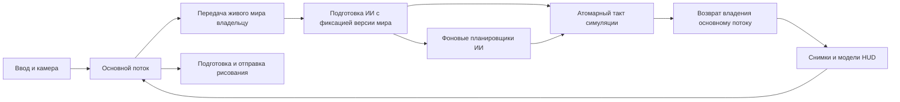

# Архитектурный разбор производительности — актуализирован 9 ноября 2026

Критерий пользователя уточнён: скорость и нормальная игра важнее совпадения с прежним алгоритмом. Побитовое совпадение с прежней симуляцией не является обязательным критерием оптимизации; допустимы другие маршруты и решения при сохранении управляемости, достижимости и отсутствия застреваний. Обычная диагностика больше не вычисляет полный SHA мира; отдельный `--fixed-state-hash` оставлен для точечной локализации расхождений. Целостность сохранений и внутреннее воспроизведение одной действующей реализации сохраняются.

### Актуальное состояние: принятые изменения и оставшаяся стоимость

**Actor atlas +healthbar batches приняты после двух реальных прогонов.** `release-source-unit-atlas-batches-long-eight-player-20261109`,400×400/8p/×2/180с/pan+jumps/autosave: все100 видимых unit sprites atlased,1 texture RID вместо18, estimated sprite submissions42 вместо181 (последний видимый кадр; число resources слегка различается). Steady frame mean18,024/p99 35,865/max50,248 мс против healthbar-only19,052/37,330/66,413 и shared-journal r2 19,078/38,447/53,982. Full67,220/actors32,624 мс: симуляция существенно не ускорилась, это исправление рендерного обхода atlas. 1793 такта,3 принятых human commands,0 rejected, сохранён736 без ошибки в isolated worker. All-moving-still intervals0, rewinding samples0; это не означает отсутствие отдельных stalled actors. Runtime errors нет, исходный2560×1080 PNG осмотрен; зеркальные ориентации, положение спрайтов, бары и tint согласованы. Healthbar batches10029 на1002803 полосы вместо2005606 rect commands.

`release-source-unit-atlas-batches-myforest-20261109`:120с/×2/pan+jumps/autosave/Main probe/hardware counters,180360→183820,сохранён180794 без ошибки,isolated worker=true,runtime errors нет. Full18,271/actors5,194 мс;steady p99 16,704/max25,124 мс (предыдущая r2 16,711/29,381). Draw mean4,054/max23,653 мс, submit mean1,357 мс,GPU mean2,067 мс. На итоговом кадре7/7 unit и1/1 unit_part atlased; выбран1 юнит, поэтому healthbar batching корректно не применялся. Новых human orders в этом сохранении не было, существующая партия продолжилась. PNG осмотрен; камера в основном над unknown terrain, не использовать это как доказательство общего terrain parity. Сводка `actor-atlas-batches-qualified-summary-20261109.json`.

Сборка `native-unit-atlas-batching-r2-build-20261109.log`, исходники и DLL соответствуют content receipt. Все диагностические процессы этого этапа завершены. No tests/suites, EXE/PCK export не выполнен. Полная цель≤20мс не достигнута: whole8p max82,685 мс, steady max50,248 мс, tick gap p99 175,529/max282,118 мс. Следующая главная стоимость — unit actor stage32,624 мс и подготовка AI с generation pin. В чистом8p замере sites8544 мкс×628,commands5008 мкс×1336,actors2572 мкс×1499,navigation553 мкс×8165; это counts порций, не per-generation averages. `controller.commands` max138124 мкс иmean2629 мкс. Не объявлять весь лаг проблемой atlas или только AI; не складывать inclusive этапы.

**Новая ветка рендера, 9 ноября: соседние health bars и atlas bypass юнитов.** Health bars объединены в один ordered triangle buffer на непрерывный префикс до512 полос. Порядок background/fill каждой полосы, цвета и snapped координаты сохранены; одиночная/неподдержанная запись использует прежний обработчик на том же месте очереди. Без новых persistent entity caches/CanvasItems. 180с/8p `release-source-healthbar-batches-long-eight-player-20261109`:949703 bars,9498 batch commands вместо1899406 rect commands; full67,183 мс против67,351, actors32,474 против32,552. Steady p99 37,330/max66,413 мс против38,447/53,982: общий эффект мал, максимум не улучшен. Во время этого замера один read-only WMI запрос занимал около8с wall wait; отдельные peaks не считать чистым сравнением. Приняты3 приказа, сохранён736 без ошибки, runtime errors нет; PNG осмотрен, bars расположены/окрашены правильно. Сводка `healthbar-batches-summary-20261109.json`.

Новый atlas admission report выявил: **100 unit sprites /0 atlased /18 texture RIDs**, тогда как environment/resources/shadows используют1 page. Причина подтверждена кодом: `cache_actor_sprites()` напрямую формирует команды исходных textures, обходя существующий bounded atlas/template cache. Добавлен `cache_actor_sprites_atlased()`, который передаёт только mobile unit/unit_part в общий кэш. Generic cache теперь сохраняет зеркальный hotspot/source region/UV и sprite[6] для интерполяции; actors не получают static projection_anchor/projection_sort_y, чтобы painter order продолжал использовать их живые screen coordinates. Внешний scalar actor API оставлен для старых callers. Сборка `native-unit-atlas-batching-r2-build-20261109.log` завершена; `release-source-unit-atlas-batches-long-eight-player-20261109` завершён; эффект и визуальная корректность подтверждены им и прогоном «Мой_Лес!» (результаты выше). Проверка отрицательной ширины source region опиралась на официальный RendererCanvasCull: исходная позиция сохраняется, флаг flip переключается, размер нормализуется. https://github.com/godotengine/godot/blob/master/servers/rendering/renderer_canvas_cull.cpp

**Текущая сборка восстановлена на qualified shared-journal r2.** Попытка lazy empty-container defaults (100 native call sites, сохранённый mutable missing/NIL контракт) не дала существенного эффекта: 180с/8p full67,351→67,004 мс, actors32,552→32,594 мс, steady p99 38,447→37,750 мс/max53,982→57,500 мс. Удалены все 100 замен и новый helper; 10 native файлов восстановлены побайтово из r2 frozen sources после проверки отсутствия других правок. `native-shared-journal-restored-build-20261109.log` завершён; `.text` восстановленной DLL идентичен qualified r2. Эксперимент повторять без новой причины не требуется. Сводка `lazy-container-defaults-rejected-summary-20261109.json`.

**Повторная диагностика презентации r2.** «Мой_Лес!», 120с/×2/pan+jumps/autosave и Main presentation probe:180360→183794, сохранён180792 без ошибки, isolated worker=true, runtime errors нет. Full18,333 мс, actors5,192 мс; steady frame p99 16,711/max29,381 мс. Draw total mean4,018/max25,020 мс, world prepare mean1,803/max17,401 мс; GPU mean2,072/max5,580 мс. Новых human commands в этом сценарии не было. Кадр осмотрен: видимая сцена и HUD согласованы, большая чёрная область соответствует текущей camera/fog, не доказывает отсутствие отдельного terrain дефекта.

Восьмипользовательский `release-source-shared-journal-eight-player-presentation-stacks-20261109` использовал Main probe, hardware counters и 60с sampler двух потоков: это поиск стоимости, не чистая оценка ускорения. Draw total mean13,013/p99 27,614 мс, world prepare6,182/world submit6,014 мс; Main process6,159 мс на ownership return. GPU mean3,485/p99 4,209 мс. 4085 wall-stack samples на поток; native `.text` совпал с сохранённой linker map. Main first-native submit_world_queue16,8%,submit_sprite_batches9,8%; owner Dictionary::get12,5% и Object::call_internal6,1%. Это wall samples с ожиданиями, не проценты чистого CPU. Имена берутся из ближайшей записи linker map; inclusive `Array::init_bindings` не считать доказанным runtime вызовом без точных границ символа. В анализатор добавлен `.text` range guard; в этой записи nontext exclusions0. Все3 приказа приняты, сохранён633 без ошибки, runtime errors нет. Сводка `presentation-stack-diagnosis-summary-20261109.json`.

**Следующий участок:** grouped submission цветных shapes и sprite batch admission. В последнем кадре973 items:509 sprites/25 texture RIDs,162 adjacent runs, estimated189 sprite submissions; дополнительно100 selection/100 shadow/100 health_bar. RenderItem уже раскладывает selection/shadow/health по отдельным слоям2/3/7: можно собирать соседние однотипные primitives в общий ordered triangle buffer без изменения painter order и без CanvasItem на каждый drawable (этот подход ранее отвергнут). Перед изменением атласов измерять реальные unatlased sprites по kind: соответствующие поля добавлены в end-of-run report `profile_saved_match_frames.gd`, compiler-only check прошёл, исполнения с этими полями пока не было. Многостраничный shader и резервирование страниц для units только рассмотрены, **не реализованы**. Цель≤20мс остаётся невыполненной; тесты и EXE/PCK export не запускались.

**Общий immutable entity delta для внутренних читателей, 9 ноября.** `read_changes_since()` выдаёт читателю собственный изменяемый descriptor, но IDs/masks/removed IDs разделяются как read-only scalar containers. Восемь внутренних систем используют этот API; публичные `changes_since()` и `CacheDependency.changes()` сохраняют прежние независимо изменяемые результаты. Кэш ограничен 8 записями по 1024 IDs, сбрасывается при flush/reset; мир и entity rows не удерживает. В r2 первый read materialize делает `collect_since()` напрямую и не заполняет лишний mutable cache. Сборка `native-shared-journal-direct-build-20261109.log` завершена, receipt исходников соответствует DLL. Fixed500 r1: 3595 shared hits, 128 journal comparisons и 512 activity comparisons без расхождений, runtime errors нет; full72,114→72,235 мс, ускорение этой короткой пары не заявляется. Длинный r1: full68,646 мс. Итоговый r2: 400×400/8 игроков/×2/180с/pan+jumps/autosave, full67,351 мс против compact-activity70,659 мс, actors32,552 против33,934 мс, 1780 против1711 тактов. 25096 shared reads, из них10656 hits; исключено глубокое копирование как на hits, так и при подготовке первого результата. Приняты3 human commands, rejected0, сохранён736 без ошибки в isolated worker. Runtime errors нет. Steady frame p99 38,447/max53,982 мс; tick gap p99 182,039/max267,004 мс: критерий≤20мс и отсутствие пауз НЕ выполнены. Сводка `shared-journal-deltas-qualified-summary-20261109.json`. Rollback только этого изменения: восстановить оба native journal файла и 9 journal/consumer GDS из frozen `release-source-compact-activity-changes-eight-player-20261109/executed-source`, пересобрать DLL. Последующие изменения проверять перед восстановлением. EXE/PCK пока не экспортированы; тесты не запускались.

**Компактная классификация activity, 9 ноября.** Native возвращает только IDs для script refresh и общие movement/formation flags вместо Dictionary на каждый стабильный actor. При coalesced boundary native producer больше не дублирует journal changes в `pending_units`: completed journal уже содержит те же изменения, а явные refresh без journal остаются в pending. Состав событий других потребителей не меняется. Проверка 512 activity predicates не обнаружила расхождений. Fixed500: activity finish 2,603→1,796 мс, registry finish 2,646→1,838 мс, publication 0,953→0,485 мс; убрано 354569 дублирующих deferred writes. Full tick 73,872→72,114 мс. Длинный 180с прогон подтвердил экономию activity finish 2,211→1,565 мс, но полный такт 69,389→70,659 мс, steady p99 36,699→38,185 мс, max 56,043→71,355 мс: общий выигрыш не подтверждён. Три приказа приняты, сохранён такт710, isolated autosave без ошибки, runtime errors нет. Правка пока сохранена за уменьшение измеренной работы этапа; окончательное решение должно учитывать следующие полные замеры. Сводка `compact-activity-changes-summary-20261109.json`. EXE/PCK не экспортированы, тесты не запускались.

**Убраны повторные literal String/Variant allocations в native actor/render/awareness/visibility контурах.** В используемом godot-cpp `src/variant/char_string.cpp` сравнение String с const-char literal создаёт `String(p_str)` при каждом вызове. `ROR_TEXT` возвращает неизменяемую строку, созданную при первом использовании после инициализации extension API; прежний `ROR_FIELD` распространён на оставшиеся буквальные ключи Dictionary в этих циклах. Изменены13 native src файлов, новых gameplay режимов/состояния/инвалидаций нет. Сохраняется семантика String и String-key Variant. Память констант ограничена самим исходным кодом, live rows не удерживаются. Сборка `native-shared-text-and-keys-build-20261109.log` завершена; DLL2005504 bytes. Первый String-only compile обнаружил ambiguous const String + const-char overload лишь в диагностическом форматировании имён counters; исходные constructors в этих4 строках возвращены до финальной сборки.

Fixed500 пара `release-source-lto-native-motion-costs-eight-player-20261109` / `release-source-shared-text-and-keys-eight-player-20261109`: full76,786→73,872мс,actors35,636→34,305мс,combat autonomy6,035→4,642мс. Оба приказа100 юнитам на10/210 приняты; все собранные gameplay counters/позиции/запасы на500-м такте совпали. Steady p99 40,572→40,483мс,max61,569→49,995мс; этот случай не доказывает кадр≤20мс. Autosave enabled,но saved=-1,не считать проверкой сохранения.

Длинный `release-source-shared-text-keys-long-eight-player-20261109` против LTO baseline:400×400/8p,×2,180с,pan+jumps,autosave,одинаковые coarse flags. Full72,721→69,389мс,actors34,648→33,158мс,combat5,701→4,367мс;1744 против1685 тактов. Steady p99 38,958→36,699мс,max53,979→56,043мс; весь max83,391мс. Все3 human commands приняты,0 rejected,сохранён719 без ошибки,isolated worker=true,runtime errors нет. Кадр осмотрен,видимая сцена/HUD без нового явного дефекта. Итог human73 idle/27 move,19 stalled movers: это не доказательство достижения всех formation goals.

`release-source-shared-text-keys-myforest-20261109`: реальная копия «Мой_Лес!»,120с,×2,pan+jumps,autosave;180360→183764,сохранён180792,error пуст,isolated worker=true,runtime errors нет. Новых human commands не было,существующая партия продолжалась. Full18,497мс,actors5,213мс;steady p99 16,698/max23,481мс,весь max63,505мс. Renderer CPU0,475/GPU2,069мс средние аппаратные counters; `--render-times` в этом запуске **не включил** `presentation_probe_enabled` (false), не приписывать ему разбивку Main draw preparation. Кадр осмотрен: большая чёрная область соответствует текущему fog/camera position, видимая часть поселения и HUD отрисованы. Сводка `shared-literal-values-keys-qualified-summary-20261109.json`. Все процессы терминальны, DLL/receipt/source hashes совпадают. Откат: восстановить13 изменённых native src файлов из frozen LTO baseline и пересобрать; LTO CMake оставить. Цель max≤20мс и достаточный8p throughput **не достигнуты**. Тесты и EXE/PCK export не запускались.

**Lazy validation GDS route geometry и отмена global recovery clear проверены и удалены.** `release-source-lto-native-motion-costs-eight-player-20261109` / `release-source-lazy-route-geometry-eight-player-20261109`:500 fixed ticks,orders10/210,×2,8p. Full76,786→77,294мс,actors35,636→35,691мс;finish4,083→3,977мс/такт. Human задачи28 idle/72 move в обоих. Lazy записи имели revision/epoch, проверялись ограниченным journal region при lookup; отсутствующая история/пересечение/negative или global cache entry инвалидировали только используемую запись. Shared terrain cache не очищался при recovery одного актёра. Работа invalidate стала ограничена обращениями, однако ускорения всего цикла не получено.

Длинный `release-source-lazy-route-geometry-long-eight-player-20261109` против `release-source-release-lto-eight-player-20261109`:180с,400×400/8p,×2,pan+jumps,autosave;1656 против1685 тактов,full73,947 против72,721мс,actors35,433 против34,648мс. Steady p99 39,584 против38,958мс,max57,113 против53,979мс.51503 cache hits,33417 validation attempts,27316 invalidations,11 explicit clears; все3 приказа приняты,сохранён693 без ошибки,isolated worker=true,runtime errors нет. Это не доказанный выигрыш. Все3 изменённых GDS файла восстановлены byte-for-byte из baseline executed-source; native DLL этим опытом не менялась. Сводка `lazy-route-geometry-rejected-summary-20261109.json`. Не повторять retention/lazy invalidation GDS terrain routes как новое решение основного лага.

Детальный профиль того же актуального LTO baseline500ticks: native movement calculate0,869мс/такт,velocity/frame load2,349,yield1,416,integrate0,604,progress0,374; native body целиком6,084мс. Route preparation3,239,finish4,151;actors35,636 иfull76,786. Вложенные scopes не суммировать повторно. Autosave этого fixed500 случая enabled,но saved=-1: не подтверждение сохранения. Literal String allocations после этого профиля сокращены и измерены выше; само вычисление steering уже занимает менее1мс/такт и не объясняет оставшиеся69мс.

**Для Release включена оптимизация при линковке (IPO/LTO) одновременно в игровом native module и godot-cpp.** CMake проверяет поддержку компиляции; MinGW использует compiler gcc-ar/gcc-ranlib и для промежуточного shared object archive. Floating-point rules и ISA прежние, fast-math не включался, алгоритмы/GDScript не менялись. DLL2516992→1822720 bytes. Сборка `native-release-lto-toolchain-build-20261109.log` завершена, actual compile flags обоих targets содержат `-O3 -DNDEBUG -flto -fno-fat-lto-objects`; flags/link command сохранены в диагностическом case. Отключение: убрать блок IPO в native CMakeLists и пересобрать обоих targets; изменение compiler flags автоматически инвалидирует godot-cpp objects, content receipt — project objects.

`release-source-release-lto-eight-player-20261109` против того же `release-source-ai-region-batch-baseline-eight-player-20261109`:400×400/8p,×2,180с,pan+jumps,autosave,одинаковые diagnostic arguments. Full tick73,595→72,721мс,actors35,338→34,648мс;1685 против1665 тактов. Все3 human commands приняты,0 rejected,сохранён690 без ошибок,isolated worker=true,runtime errors нет; кадр осмотрен, заметных дефектов сцены/HUD нет. Steady p99 39,282→38,958мс,max60,851→53,979мс; весь max82,411→86,206мс. Это **не устранение основного лага**: средний выигрыш мал, максимум≤20мс не достигнут. Сводка `release-lto-qualified-summary-20261109.json`. DLL/receipt/source inputs совпадают, процессы терминальны; тесты и EXE/PCK export не запускались.

**Пакетные component queries для AI region targets проверены и удалены.** `release-source-ai-region-batch-baseline-eight-player-20261109` / `release-source-ai-region-batch-eight-player-20261109`: настоящая Release-графика,400×400,8p,×2,180с,pan+jumps,autosave. Попытка заменяла appearance-based invalidation точными cell/domain/restriction/radius/grid зависимостями и объединяла component lookups одного профиля в native вызов. Навигационная подготовка на AI capture7,616→7,471мс, весь capture37,360→36,827мс; full tick73,595→73,079мс, actors35,338→34,983мс. Steady p99 кадра39,282→39,299мс; существенного общего выигрыша нет.1676 против1665 тактов; все3 приказа приняты в обоих, сохранены687/690 без ошибок, isolated autosave=true, runtime errors нет.9888 cache hits,48657 queried actors,7216 batches не оправдывают дополнительный API и граф временных query records. Все четыре изменённых файла восстановлены byte-for-byte из baseline executed-source, дополнительное поле manual report удалено, Release DLL пересобрана после удаления; receipt inputs/DLL SHA совпадают. Сводка `ai-region-batch-rejected-summary-20261109.json`. Не возвращать этот опыт как решение основного лага. Тесты и EXE/PCK export не запускались.

**Сокращены повторные catalog reads в AI actor profiles.** В существующем `_ai_profile_cache` одной закреплённой observation generation сохраняются четыре числовых source IDs для town center/granary/storage pit/dock по owner. Новый снимок начинает новый кэш; мир, сущности и определения каталога там не удерживаются. Каждый worker по-прежнему получает собственные актуальные drop-site/delivery списки; транспорт, ресурсы в руках, текущая роль и tactical поля вычисляются прежним способом. Обычные вызовы без generation cache работают без межвызовного хранения. Отдельных gameplay-переключателей нет.

`release-source-ai-actor-catalog-eight-player-20261109`:400×400/8p,×2,180с,pan+jumps.2336 разрешений каталога и23199 worker reuses вместо95132 чтений прежнего цикла (без учёта отдельных diagnostic reference calls);128 сравнений актуального профиля с исходным расчётом,0 расхождений. Такты0→1665, все3 приказа приняты, сохранён690 без ошибки, isolated worker=true. В ближайшем предшествующем таком же запуске query-command работа на AI capture составляла8,310мс, здесь7,665мс; вся подготовка37,632 против37,272мс. Общий throughput не улучшился, процент общего ускорения не утверждается. Steady p99 39,291/max57,616мс, весь max82,828мс: цель не выполнена.

`release-source-catalog-checkpoint-myforest-20261109`: копия «Мой_Лес!»,400×400,×2,180с с camera jumps; такты180360→185199, сохранён182412, error пуст, isolated worker=true, runtime errors нет. Ещё128 сравнений профиля без расхождений;7740 catalog lookups и39155 worker reuses. Новых human commands этот сценарий не посылал (ingress0), существующие приказы продолжались. После15с p99 16,704/max24,944мс; весь max65,751мс. Сводка `ai-actor-catalog-qualified-summary-20261109.json`. Тесты не писались/не запускались, EXE/PCK не экспортированы. Оба последних изменения квалифицированы в реальных графических запусках, однако устранение основного отставания симуляции на8p и максимум≤20мс не подтверждены.

**Исправлены повторные поздние detour-проверки при удерживаемом stuck counter.** Когда formation yielding не продвигал `stuck_ticks`, условие `[60,180,360,720]` повторно запускало поиск каждый такт. Native и script пути теперь проверяют переход через отметку, используя прежнее значение счётчика; сериализованного состояния или нового режима нет. В паре `release-source-gather-stage-costs-eight-player-20261109` / `release-source-traffic-checkpoint-edges-eight-player-20261109` (500 тактов,100 юнитов, приказы10/210) исключено46 удерживаемых вызовов, число успешных traffic routes57 в обоих. Показатели всех команд по units/cargo/gather cycles/stalled/pathless orders и запасам совпали; полный SHA не вычислялся. Полный такт76,881 против77,177мс, actors35,652 против35,831мс: **общего ускорения не доказано**. Это исправление события, не устранение основной причины лагов.

Длинный `release-source-traffic-checkpoint-edges-long-eight-player-20261109`: 400×400/8p,×2,180с,pan+jumps, нормальный input ingress; такты0→1677,763 checkpoint entries,145 held calls пропущены, все3 приказа приняты, сохранён690 без ошибки, isolated worker=true. Runtime errors отсутствуют. Steady p99 38,454/max88,728мс, цель не достигнута. Новая диагностическая сводка содержит фактические задачи, расстояния до назначенных целей и число застрявших movers; финальное состояние human100:73 idle/27 move,13 с `stuck_ticks>=30`. Это не доказательство достижения всех формационных назначений. Compiler-only check следующей GDS-правки начался4:27:22, после измерения4:24:10→4:27:10. Сводка `traffic-checkpoint-edge-fix-summary-20261109.json`.

Детализация native gathering того же500-tick baseline: motion4,194мс/такт, resource resolution1,501, script continuation1,296, action0,954, shortening0,783, adoption0,669, range/slots0,320, returning0,194, setup0,111, destination0,081. Эти вложенные измерения не складываются с общим actor/gather временем повторно. Само по себе индексирование reservations или кэширование adoption не объясняет основную стоимость.

Эксперимент локальных сертификатов native raw A* cache **удалён до следующего сравнения**. Его baseline `release-source-local-route-cache-baseline-eight-player-20261109` завершил500 тактов: full76,948мс, actors34,945мс;9653 raw calls,6421 searches,1340979 expanded,672688µs суммарного A* в owner kernels, то есть1,345мс/такт. Это не включает все расходы сглаживания/обходов и фоновые AI kernels, но ограничивает выигрыш именно этого кэша. Изменённые `ror_path_kernel.cpp/.hpp` и `pathfinder.gd` восстановлены из замороженного принятого источника; native DLL пересобрана. Не восстанавливать сертификатный raw cache как основное решение фризов. Сводка `local-route-cache-abandoned-summary-20261109.json`.

**Передача владения по deferred-уведомлению проверена, отклонена и удалена.** Текущий Release-сценарий `release-source-owner-handoff-current-eight-player-20261109`: 400×400,8 игроков,×2,180с, camera jumps и autosave. Такты0→1477, полный такт82,796мс, actors40,102мс. Между запросами: ожидание готового результата9,772мс и работа главного потока7,117мс в среднем. Сохранён662, isolated worker=true, все3 приказа приняты; runtime errors отсутствуют. Steady p99 44,596/max85,227мс. Отдельный30-секундный CPU-срез после появления расчётного потока: два наиболее занятых потока потребляли99,5% и84,6% одного ядра. Сам по себе этот срез не доказывает конкретные функции или нехватку всех ядер.

`release-source-owner-event-handoff-eight-player-20261109`: тот же сценарий с уведомлением главного потока сразу после расчёта и отдельным preparation budget каждого ownership window.1485 event resumes, такты0→1402. Ожидание результата сократилось до6,670мс, но полный такт вырос до90,666мс, steady p99 до70,269/max318,859мс. Сохранён133 без ошибки, все3 приказа приняты; runtime errors отсутствуют. **Уменьшение локального ожидания не ускорило игру.** Callback, новый режим, его environment flag и реорганизация main process полностью удалены; окончательный ограничитель одного refresh на кадр также удалён и не объявляется проверенным. Оставлены только выключенные по умолчанию замеры `--profile-owner-handoffs`. Не повторять deferred-перезапуск owner как новое доказанное решение. Сводка `owner-event-handoff-rejected-summary-20261109.json`. Тесты не писались/не запускались, EXE/PCK не экспортированы; цель не достигнута.

**Принята публикация данных управления по событиям, включена по умолчанию** (`ROR_DIAGNOSTIC_COMPACT_UI_CONTROLS=0` — прежний полный путь). Контракт `EntityReadContract.UI_COMPONENT_FIELDS/UI_CONTROL_FIELDS` включает данные HUD, курсора и перевозки; данные готовятся для всех легально видимых объектов до изменения выбора. Native factory создаёт собственные неизменяемые графы, кэш8192 записей не удерживает сущности. Версии UI живут отдельно от сохранения, меняются в mutation facade при изменении зависимостей и при общих domain notifications. Горячие native движение/анимация меняют только поля вне этого контракта. Прямые изменения веры и торгового состояния явно уведомляют кэш. Версии удаляются при гибели/погрузке и сбрасываются при загрузке; мир/epoch инвалидируют записи.

Один лишь компактный schema projection был медленнее прежнего COW: `release-source-compact-ui-controls-alternating-eight-player-20261109`, публикация11,671 против11,143 мс. Он не принят как отдельное ускорение. В `release-source-incremental-ui-controls-alternating-eight-player-20261109` обновление по событиям дало полную публикацию6,943 против11,214 мс (775/806 измерений одной партии;30 сравнительных публикаций исключены из пары). 81423 version hits и554 пересчёта,30 HUD/303 context comparisons без расхождений. 400×400/8 игроков, ×2,180с, camera jumps; такты0→1617, все3 приказа приняты, сохранён670 без ошибки, isolated worker=true. Кадр max84,190 мс, steady p99 38,945/max53,713 мс: цель не достигнута.

`release-source-incremental-ui-controls-myforest-fixed-20261109`: копия «Мой_Лес!»,180с, camera jumps, ×2. 55512 сравнений UI полей всех опубликованных юнитов,32 HUD/369 context comparisons без расхождений;204804 version hits и1197 пересчётов. Такты180360→185092, сохранён182412 без ошибки, isolated worker=true; runtime errors отсутствуют. Отдельных человеческих приказов этот сценарий не отправил, поэтому ingress=0 не служит подтверждением кликов. Кадр max64,625 мс; после15с p99 16,721/max25,296 мс. Найденное здесь расхождение оказалось устаревшим `global_queue.remaining_seconds`: динамическое обновление меняло progress, но не оставшееся время. Обновление времени исправлено, повтор прошёл. EXE/PCK не экспортированы, наборы тестов не запускались. Сводка `incremental-ui-controls-accepted-summary-20261109.json`.

Свежая детализация акторов `release-source-current-actor-stage-costs-eight-player-20261109`: 500 тактов, приказы100 юнитам на10/210, Release `-O3`, обе предыдущие оптимизации HUD/поз уже включены. Полный такт82,596 мс, actors36,751; movement16,416, gather11,977, domain3,782, preparation3,008 мс. Вложенные motion native body6,466 / finish4,511 / route preparation3,474 мс не складываются с родительскими этапами повторно. Autosave не завершился (`saved_tick=-1`), поэтому подтверждением сохранения этот запуск не является.

Эксперимент с локальной арифметикой вместо Geometry2D ABI внутри traffic loops, общим native body predicate и native проверкой последнего участка формации **отклонён и удалён**. `release-source-direct-traffic-geometry-eight-player-20261109`: полный такт82,728 против82,596 мс, actors36,564 против36,751, finish4,577 против4,511; только route preparation3,100 против3,474 мс. Все3562 проверки конечного участка были native, fallback0, но заметного выигрыша полного контура нет. Итоговые per-team units/cargo/gather cycles/stalled/pathless counters в двух партиях совпали; полный SHA мира не вычислялся. Max кадра64,650 мс, цель не выполнена. После удаления заново собрана native DLL; от этого эксперимента в рабочем коде нет новых API, полей или переключателей. Сводка `direct-traffic-geometry-rejected-summary-20261109.json`. Больше не рассматривать этот перенос геометрии как доказанное средство ускорения.

Принят ограниченный общий кэш поз юнитов (4096 записей; отключение `ROR_DIAGNOSTIC_UNIT_POSE_CACHE=0`). Ключ содержит texture/team/source, запрошенную анимацию, facing и точное animation time без округления; базовые composite parts неизменяемы. Урон/огонь добавляются отдельно на актуальном ambient clock, сущности в кэш не попадают. Завершение загрузки клипа и shutdown очищают записи. `release-source-unit-pose-cache-alternating-eight-player-20261109`: 180 с 400×400/8 игроков, ×2, camera jumps и autosave, режимы чередуются блоками по32 кадра. 55950 hits / 16070 misses; подготовка units 5,994 против7,319 мс (709/725 измерений), весь draw14,238 против14,514 мс, кадр21,916 против22,216 мс. HUD placebo3,700 против3,726 мс. Такты0→1361, три приказа приняты, сохранён133 без ошибки, isolated worker=true; runtime errors отсутствуют. Общий max104,991 мс: эффект компонента принят, цель ≤20 мс не достигнута. Сводка `unit-pose-cache-accepted-summary-20261109.json`.

Принят и включён по умолчанию расчёт подписи HUD по зависимостям модели (отключение `ROR_DIAGNOSTIC_GROUPED_HUD_SIGNATURE=0`): детальные поля подписываются у ведущего юнита и первого подходящего строителя; у остальных отслеживаются только членство, состав и возможности группы, которые читает панель. `release-source-grouped-hud-signature-alternating-eight-player-20261109`: 120 с 400×400/8 игроков, ×2, camera jumps и autosave; 502 grouped и510 full вызовов в одной партии. Подпись0,564 против2,186 мс в среднем, p99 0,938 против3,872 мс; 29 сравнений показанной модели с полной пересборкой без расхождений. Unit pose cache постоянно включён: 80998 hits / 20402 misses. Такты0→964, оба запланированных за120 с приказа приняты, сохранён127 без ошибки, isolated worker=true, runtime errors отсутствуют. Max кадра86,383 мс; после15 с p99 42,245/max67,138 мс. Это ускорение подготовки панели, а не доказательство устранения остановок юнитов. Главный оставшийся приоритет — throughput обработки акторов; 964 такта за120 с не обеспечивают40 тактов/с, требуемых при ×2. Сводка `grouped-hud-signature-accepted-summary-20261109.json`. Тесты не писались и не запускались; EXE/PCK не экспортированы.

Проверена гипотеза общей очистки geometry cache при mobile-заторе. Два отдельных графических запуска одного400×400/8p сохранения до500такта, одинаковые приказы10/210, без автосохранения и pan: `release-source-recovery-geometry-cleared-eight-player-20261108` и `release-source-recovery-geometry-retained-eight-player-20261108`. Первый:836 global recovery очисток,21376 выброшенных записей; full tick92,352мс, actors42,289мс. Второй:836 сохранённых поколений,0 выброшенных этой политикой; full tick93,173мс, actors44,138мс. Все итоговые per-team gameplay counters (units/cargo/gather cycles/stalled/pathless orders) совпали. **Одного сохранения кэша недостаточно, выигрыш не доказан**: оставшиеся проверки изменений геометрии исполняются вложенным GDS циклом по выросшим таблицам. Не выдавать уменьшение clear_us за ускорение симуляции.

Вариант с сохранением geometry cache и native invalidation **отклонён и полностью удалён**, как и его диагностические переключатели. `release-source-native-retained-recovery-geometry-eight-player-20261108` завершил500тактов без runtime errors; все вызовы проверки были native, fallback=0. Однако полный такт95,754мс и actors44,389мс против92,352/42,289 исходного режима не показали выигрыша. Сокращение clear_us не устранило стоимость восстановления/поиска маршрутов. Исходный recovery порядок восстановлен; native DLL заново собрана9ноября, receipt соответствует источникам. Нельзя трактовать этот эксперимент как принятую оптимизацию. Сводка `native-recovery-geometry-rejected-summary-20261109.json`.

Принят и включён по умолчанию ограниченный архив graphics records декораций (65536 записей / 512 MiB оценки; отключение `ROR_DIAGNOSTIC_ENVIRONMENT_ARCHIVE=0`). Записи и береговые meshes готовятся порциями в загрузке; viewport query определяет видимость, source identity и подпись проверяются перед reuse. Архив очищается при смене мира, не содержит живых сущностей или скрытой памяти ресурсов. В `release-source-prepared-environment-eight-player-20261109` подготовлены 16083 записи / 45009288 оценочных байт, получены 9067 hits; CPU-подготовка 1,348 с. За 180 с: такты 0→1388, все 3 приказа приняты, сохранён такт 647 без ошибки. Steady p99 47,642 мс, max 78,964 мс; задача производительности не решена. Замороженные изображения с архивом и с новой подготовкой совпали; это проверка данного изменения графики, а не обязательный эталон для новых алгоритмов симуляции.

При обычном старте новой карты обнаружена отдельная причина GPU-ошибки `Element limit reached`: пока full-map terrain ещё не готов, `_draw` уходил в прежний per-cell fallback, создающий временные ArrayMesh. Во время подготовки теперь отображается загрузка без этого второго представления земли. `release-source-fresh-loading-fallback-fixed-eight-player-20261109`: normal fresh startup, 400×400, 8 игроков, ×2, 180 с игры с camera jumps и автосохранением; terminal 0, runtime errors отсутствуют. За загрузку 710 кадров подготовки окружения, максимальный tick=0; fallback draws=0 и fallback material meshes=0. Все 400 строк terrain готовы, 16083 environment records, 9241 hits. Такты 0→1550, все 3 приказа приняты, сохранён 636 без ошибки, worker изолирован. Кадр mean 19,968 мс / p99 42,156 мс / max 79,940 мс; полный такт mean 74,870 мс, actors 36,689 мс. Между этими разными партиями процент общего ускорения не утверждается. EXE/PCK не экспортированы; тесты не писались и не запускались.

Удалён целиком предварительный movement batch scan, когда текущий такт уже принадлежит combined owner dispatch. Старое поколение jobs перед выходом по-прежнему завершается/отбрасывается. Скриптовые fallback-движения получают скорость непосредственно из того же pure kernel, без подготовки будущего результата. `release-source-owner-movement-dispatch-stage-costs-eight-player-20261108`: 247 owner-only тактов против253 прежних; подготовка0,022 против0,858 мс, actors45,889 против46,250 мс (разница основной обработки не доказана). Это экономия около0,84 мс подготовки, не решение общей производительности. Оба фиксированных приказа запланированы на10/210, прогон завершил500 тактов без runtime errors. Autosave ещё не завершён (saved_tick=-1), подтверждением сохранения этот прогон не является. Отключение `ROR_DIAGNOSTIC_OWNER_MOVEMENT_DISPATCH=0`; сравнение `--profile-movement-dispatch-alternatives`.

Свежая детализация того же прогона: actor_total44,462 мс/такт; movement19,365, gather12,987, preparation4,498, animation2,867, publication0,953 (publication вложена в другие этапы). `_finish_native_move`4,715 мс/такт, `_prepare_move_route`2,911, скриптовая анимация1,557. Отдельная подтверждённая лишняя работа: глобальный `resource_digest_job` переводит все unit timers/animations и route preparation на скрипт, хотя `BackgroundAutosave.prepare_capture_on_owner` запускает digest только для `world.get_resources()`, то есть resource_nodes. Получено181095 скриптовых анимаций и55659 скриптовых подготовок маршрута.

Принято ограничение checksum-защиты конкретным ресурсом: native owner span захватывает Ref на канонический RoRResourceDigest один раз и вызывает его идемпотентный before_change(id) до первой записи actor/route. Несовпадающие ID не входят в digest; попавший в него ресурс будет хеширован до изменения. Объект/ссылки не переживают синхронный span. Неизвестный/переопределённый job оставляет прежнее поведение. Политика `ROR_DIAGNOSTIC_SCOPED_RESOURCE_DIGEST=0` возвращает прежний глобальный guard; сравнение `--profile-scoped-resource-digest-alternatives`.

`release-source-scoped-resource-digest-alternating-eight-player-20261108`: 180 с графической игры 400×400/8 игроков, оба режима в одной партии, без подробного per-actor/script-boundary профилирования. 669 scoped тактов против674 прежних; полный такт85,422 против89,054 мс (около4,1%), actors41,347 против44,560 мс. 391485 actor-вызовов scoped,159279 вызовов before_change при живом checksum job. Такты0→1343, сохранён639, autosave_error пуст, isolated worker=true, runtime errors отсутствуют. Prepared scene ready=true. Кадр max129,547 мс; после15 с p99=51,131 мс/max129,547 мс. Поэтому цель ≤20 мс не достигнута. Сводка `scoped-resource-digest-accepted-summary-20261108.json`. Обычный combined owner dispatch уже включён в обоих режимах; к нему нельзя повторно прибавлять ранее вложенные таймеры как независимые расходы. Native сборка и compiler-only проверка прошли; игровые тесты не писались и не запускались, EXE/PCK не экспортированы.

Полная подготовка земли и producer render scene теперь включены по умолчанию. Инициализация native terrain kernel выполняется до запуска PreparedScene; промежуточный viewport mesh больше не строится. Завершённый ряд с нулём непрозрачных треугольников считается допустимым пустым рядом. Первый запуск `release-source-default-prepared-scene-eight-player-20261108` выявил пропущенную инициализацию: flag=true, но scene отсутствовала; его нельзя использовать как подтверждение новой реализации.

Исправленный `release-source-default-prepared-scene-r2-eight-player-20261108`: 180 секунд настоящей графической игры, 400×400, восемь игроков, скачки камеры, автосохранение. Готовы 400 рядов, 24842108 вершин, 1375006068 байт числовых буферов; подготовка 17,297 с входит в загрузку. Такты 0→1316, сохранён 630, ошибка сохранения пустая, isolated worker=true. Максимальный кадр 146,305 мс вместо 521,773 мс первого запуска; после 15 с p99=52,057 мс, max=137,751 мс. Пики синхронного построения земли исчезли. Оставшиеся пики относятся преимущественно к подготовке и отправке спрайтов при скачке камеры: на 60,20 с world_prepare=73,788 мс и world_submit=31,846 мс. Средний полный такт симуляции 89,978 мс, p99=144,670 мс. Цель кадра ≤20 мс и нормального темпа симуляции не достигнута. Цена устранения terrain-паузы — память и дополнительная работа при загрузке, а не бесплатное ускорение. EXE/PCK пока не экспортированы.

Вариант с отдельным сохраняемым CanvasItem на каждый элемент **отклонён и полностью удалён из рабочего кода**. Первый запуск `release-source-retained-world-alternating-eight-player-20261108`: 0 принятых кадров из2606 попыток из-за неподдерживаемых береговых сеток. Повторный `release-source-retained-world-shore-alternating-eight-player-20261108` добавил команды береговых mesh: 766 принятых кадров из1653 попыток, остальные887 вернулись на прежний путь для другой environment-геометрии. В принятой группе средний кадр28,542 мс, draw.total20,308 мс; в группе остальных кадров26,822 и18,512 мс. Группы зависят от содержимого viewport и потому не доказывают точный процент замедления, но общего выигрыша режим не показал. В нём уже были2004687 переиспользований команд, однако2035560 обновлений transform и повторные обходы/сравнения всё равно остались. Не переносить этот код в Release и не объявлять его ускорением. Сохранены только снимки исходников и результаты диагностики в QA.

Основной следующий приоритет — симуляция: в принятом default-prepared запуске unit_orders59,969 мс, из них actors44,469 мс, contacts4,426 мс, native_movement_snapshot4,271 мс. Fog7,998 мс; полный такт89,978 мс. Одной экономии canvas-команд недостаточно для устранения остановок юнитов. Ранее принятые изменения земли/публикаций/движения сохранены; EXE/PCK не экспортированы.

Последний frozen Release-прогон всех текущих изменений: `release-source-control-capture-keys-planar-myforest-20261108`, завершён без runtime errors. Такты180360→182266 за90с, сохранён180712, autosave_error пуст, isolated worker=true. 4010 control и1696 enriched building row сверок без расхождений; fallback/mismatch counters отсутствуют (0). У игрока1 gather cycles57903→60198, stalled0→0. Кадр max92,356мс; после15с p99 20,986/max44,279мс — общая цель не достигнута.

Prepared terrain теперь18849905 вершин/1038035844байт числовых buffers, подготовка10,172с. Это около38% меньше прежнего полного terrain; режим всё ещё opt-in, около1ГБ ground buffers остаётся существенной ценой. Producer scene тоже opt-in. Никакого нового desktop EXE/PCK пока нет. Сводка `control-capture-keys-planar-myforest-summary-20261108.json`.

Непосредственный следующий участок: синхронная ветка `terrain_canvas.gd::_ensure_visible_coverage`, особенно `NativeTerrainMesh.build_request(...,2)` при camera jump; coast остаётся16. Ранее подтверждены372мс этой сборки и451мс camera terrain в одном кадре. Завершение задачи требует убрать работу этого масштаба с кадра перемещения камеры и одновременно обеспечить полный ландшафт сразу, а не скрыть задержку пустым/неподгруженным участком. Отдельно остаётся throughput симуляции8игроков около90мс вместо25мс; улучшения DTO не заменяют эту работу. Все процессы этих диагностик и native builds терминальны.

Сокращение planar base terrain включено по умолчанию. На строго affine-height клетке непрозрачный нижний слой имеет постоянные lighting/alpha; сохраняются крайние интервалы исходной сетки, где UV clamping меняет наклон. Все overlay-сетки и веса, неплоские клетки остаются прежними. Числовой request несёт bool режима; нет общей изменяемой политики kernel для worker jobs.

Парные полные meshes одного87×88 участка:2090808→1358600 вершин,10550229→6631155 индексов; сохранены1306358 треугольников. Native build575,796→493,721мс при последовательном построении; долю времени кадра этим сравнением не утверждать. Парные кадры одной остановленной сцены осмотрены:2629 пикселей из2764800 различаются (0,095%), среднее отклонение0,013/255 по каналу; max101 связан с nearest-выбором соседнего текселя при изменённом разбиении, HUD идентичен. Сводка `planar-base-terrain-summary-20261108.json`.

**Скачок камеры всё ещё не исправлен:** `release-source-planar-terrain-eight-player-20261108` на40,59с даёт578мс кадр,451мс camera_terrain,372мс coverage_build. Уменьшение геометрии недостаточно: `_ensure_visible_coverage` продолжает синхронно строить отсутствующий видимый участок с полными coast16 subdivisions. Следующая архитектурная граница — убрать этот объём вычислений/загрузки с кадра смены камеры, обеспечив немедленно полный корректный ландшафт. Полная prepared scene пока opt-in и ранее потребляла1,687ГБ; новый общий расход ещё измеряется в Forest. Нельзя выдать уменьшенную геометрию за решение этой паузы.

Capture теперь возвращает признак сохранённой идентичности из самой рекурсии. Scalar возвращается без преобразования; Dictionary/Array сохраняет identity ровно при отсутствии клонирования; packed buffers всегда отделяются. Readonly parent с mutable child по-прежнему получает отделённую ветку; Object/Callable/RID/Signal отвергаются. `release-source-capture-identity-alternating-eight-player-20261108`: freeze0,168 против0,204мс, полная публикация14,045 против14,076мс — существенный общий выигрыш не доказан. 450тактов/оба приказа приняты. Autosave enabled, но saved_tick=-1 и готового файла нет: это **не** подтверждение сохранения. При скачке камеры40,58с кадр560мс, из них terrain446,6мс. Сводка `capture-identity-summary-20261108.json`.

Кэш literal имён в actor/gather/movement проходах включён: RAII Field/Property держит либо неизменяемый static ключ, либо прежний временный ключ до конца выражения. Ничего из мира не удерживается, thread-local политика ограничена одним синхронным owner span. `release-source-cached-actor-keys-alternating-eight-player-20261108`: actor40,517 против41,682мс, полный такт89,637 против91,424мс. 936720 cached fields и1209945 cached properties; 512 contact/233motion сверки без расхождений. Это небольшой выигрыш, цель25мс/такт и кадра≤20мс не достигнута. Сводка `cached-actor-keys-summary-20261108.json`.

Planar base compaction проверен/включён; актуальные результаты выше. EXE/PCK не экспортированы.

Принята передача завершённых building control rows без повторного обхода неизменённых частей. Источник доказательства — точные дочерние контейнеры private записи, созданной самим native project_retained_control по каноническому контракту rendered DTO; произвольного readonly-флага недостаточно. Новые/изменённые дочерние значения проходят Capture, packed buffers отделяются. Таблица ограничена8192, очищается на load/epoch и обрезается по опубликованным зданиям; живых сущностей в ней нет. Скрытые здания получают только уже законную входящую memory projection.

`release-source-building-row-capture-alternating-myforest-20261108`: 600 новых публикаций в среднем15,752мс против604 прежних18,518мс, включая подготовку и freeze. 31800 строк,159000 переиспользованных контейнеров; 901 сверка значений без расхождений/fallback. Такты180360→182280, сохранён180702 без ошибки, worker isolated. После15с p99 кадра18,966мс/max41,361мс. Результат относится к opt-in producer scene / prepared terrain; общая цель8игроков max20мс не выполнена. Сводка `building-row-capture-accepted-summary-20261108.json`.

В работе следующий общий проход Capture: передавать признак сохранённой идентичности из самой рекурсии вместо повторных UtilityFunctions::is_same для каждого скаляра/элемента. Typed buffers по-прежнему копируются, mutable descendant readonly-родителя отделяется, Objects/Callable/RID/Signal отвергаются. Публичная compatibility capability сохранена для старой DLL. Ускорение этого шага пока не измерено.

Последняя проверка «Мой_Лес!» текущих изменений завершена: загрузка с прогрессом 148,124 с, такты 180360→181884 за90с, автосохранён180612 без ошибки, isolated worker=true. Contact298 и motion82 сверки без расхождений; 1523 native delta, fallback0. У игрока1 gather cycles57903→59744, stalled0→0. После15с p99 кадра28,726 мс, max48,677; первый интервал72,426. Это хуже предыдущего17,481/27,223 и **не подтверждает улучшение общей плавности**. Текущий захват пересекается с отдельным внешним ccx процессом72992 (392,7CPU-с за наблюдаемый интервал); в предыдущем захвате такого процесса не было. Это смешивающий фактор, не доказательство единственной причины ухудшения. Внешние процессы не менялись. Producer scene / prepared terrain были opt-in; десктопный EXE/PCK не экспортирован. Сводка: `selection-lifecycle-myforest-summary-20261108.json`.

Следующее существенное ограничение: публикация UI идёт между тактами. В последнем Forest units.control_projection4,551мс и scene.freeze5,308мс на публикацию; полный такт26,631мс и owner.request66,172мс. Их нельзя складывать как одинаково частые/независимые показатели. Предмет следующего изменения — завершённая публикация control/building DTO и её повторное копирование. Приступать по текущему коду; не требовать прежнего маршрута или полного SHA старой симуляции. Сохранить законную память скрытых зданий, готовность команд при выборе и отсутствие живых ссылок через поток. Рост общего такта8игроков всё ещё требует отдельной структурной работы.

Нативный потребитель delta для movement snapshot включён по умолчанию: фильтрует упорядоченные ID/маски и смену domain/restriction за один вызов вместо повторного прохода GDScript. В одной партии: 223 native прохода в среднем 1,328 мс против 226 script проходов 2,058 мс, fallback=0. Разница полного такта 86,366 против 86,560 мс меньше вариации; не переносить процент компонента на общий такт. Последняя партия завершила 450 тактов, оба приказа 100 юнитам приняты на 10/210, 512 contact checks и 233 motion checks без расхождений. Max кадра 91,390 мс — цель не достигнута.

Обычные создание, завершение/отмена строительства и посадка/высадка теперь обновляют видимость через entity journal; полный update остаётся для загрузки/замены сценария и дипломатической топологии. Регистрация новой сущности перенесена перед обновлением обзора, иначе delta не увидела бы её в том же вызове. В партии 483 refresh через delta, полных проходов 0 против33 в предыдущей партии. Устранено повторное навязывание full scan при локальном событии; средняя общая fog phase 8,334 мс не доказывает ускорения всего контура. Это не ослабляет видимость: локальное lifecycle/capability событие публикуется сразу, прочие перемещения остаются в прежней четырёхфазной очереди. Статически просмотрены транспортные пути; все транспортные комбинации этой партией не покрыты. Сводка: `movement-delta-summary-20261108.json`.

Кольца выделения теперь используют повторно применяемый mesh вместо пересборки polyline при каждом draw. Кэш принадлежит renderer, ограничен 128 геометриями, не удерживает мир и освобождает RIDs при уничтожении; нестандартная геометрия/переполнение используют обычный draw. Порядок наложения спрайтов сохранён. В первом варианте кольцо оказалось визуально толще; R2 применяет компенсацию AA из Godot 4.7. Парные кадры одной остановленной сцены: 107 различных пикселей из 2764800, максимум 1/255 по каналу, HUD совпадает. В чередующейся Release-партии 450 тактов: draw preparation 14,597 против 17,396 мс; 112102 повторных использования одного mesh, без fallback. Это около 2,8 мс экономии основного потока, не устранение лагов симуляции. Полный такт 86,655 мс, max кадра 80,612 мс. Сводка: `selection-mesh-accepted-summary-20261108.json`; отключение для диагностики — `ROR_DIAGNOSTIC_SELECTION_MESHES=0`.

Актуальный принятый шаг — native contact frame: данные пространственного индекса и свойства юнитов читаются один раз на проход, запросы соседей работают с компактными строками, каноническая коррекция и её порядок сохранены. При чередовании в одной Release-партии 450 тактов контакты 4,570 против 6,276 мс; полный такт 88,534 против 91,978 мс. 305 сверок запросов без расхождений, 0 отказов. R2 дополнительно ограничивает область заимствованных Variant; отдельного ускорения R2 относительно R1 не установлено. Сводка: `native-contact-frame-summary-20261108.json`.

Текущий Release «Мой_Лес!»: такты 180360→182370 за диагностический интервал 90 с, сохранён 180682 без ошибки; 385 contact checks и 99 motion checks без расхождений, отказов нет. p99 19,580 мс; после первых 15 с p99 17,481 и max 27,223 мс. Producer scene / prepared terrain остаются opt-in, поэтому это не доказательство плавности обычного desktop-пакета. Восемь игроков всё ещё значительно отстают: полный такт около 90 мс вместо бюджета 25 мс. Общая цель не достигнута.

Отдельный 30-секундный stack capture трёх потоков выполнен только у собственного диагностического PID. Linker map сверена с .text фактически запущенной DLL и сохранена рядом с capture. Из 2046 wall samples основного потока 211 имели первым native-предком canvas_item_add_polyline; 216 проходили через submit_selection_ellipse. Выборка включает ожидания и влияние sampler, поэтому проценты не являются CPU-профилем и интервалы кадров этой партии не квалифицируют плавность. Переиспользование selection geometry проверено и включено по умолчанию (результаты выше); EXE/PCK не экспортированы.

Предыдущий принятый шаг — чтение полей `RoRActorMotionFrame` без временных Variant-копий через const-index API godot-cpp, с предварительным has() для отсутствующих необязательных ключей. Указатели используются только внутри загрузки одного frame, до любых записей/callbacks; между тактами не сохраняются. Первый запуск выявил ошибку отсутствующего navigation_progress и остановлен; R2 исправлен и завершён. В одной Release-партии: 110470 новых загрузок, 233 сверки математики без расхождений/отказов; такт 85,726 мс с новым чтением против 88,466 мс с копированием. Средний такт всей партии 87,108 мс, max кадра 127,525 мс. Сводка: `borrowed-motion-fields-summary-20261108.json`.

Перенос `_separate_mobile` в native отклонён и полностью убран из текущих исходников. При 760 вызовах коррекции за 450 тактов контакты 6,159 мс в native-режиме против 6,090 мс в script-режиме. 26 сверок геометрии без расхождений, но нужного эффекта нет. Эта гипотеза привела к последующему принятому contact frame; перенос редких коррекций оказался ненужным. Восстановлены все затронутые файлы, DLL и content receipt из принятого R2; SHA c2735d99e25232378dc0c804dfb301cf830aa0b4432969f9fef3e2461a184656. Сводка: `contact-separation-rejected-summary-20261108.json`.

Release «Мой_Лес!» с новым чтением: 85864 updates, 99 сверок без расхождений, такты 180360→182368, сохранён 180704 без ошибки. p99 кадра 19,762 мс, steady max 43,819 мс; первый интервал 65,105 мс. Этот frozen run также включал позднее удалённую contact-оптимизацию (205 сверок геометрии без расхождений), поэтому не является точным финальным прогоном после отката. Scene/terrain режимы остаются opt-in. Goal по восьми игрокам и max≤20 мс не выполнен, EXE/PCK не экспортированы.

На текущем шаге исправлена избыточная инвалидизация: COMBAT теперь явно включает смену task, combat_pursuit, behavior_tags, footprint_radius и замену components; прямые сбросы pursuit и target_id перенесены в setter. В native combat roster обычное движение проверяет только смену 4-клеточного пространственного bucket; остальные 11 фактов перечитываются при lifecycle/combat/ownership. 304563 коротких проверки, 6105 полных, 1024 диагностические сверки пропущенных фактов без расхождений и 32 сверки команд без расхождений. Поворот/desired_velocity/elevation больше не обходят уже существующую четырёхфазную очередь движущихся источников обзора; технологии и замена capabilities публикуют COMBAT и обновляют обзор сразу.

В двух последовательных source-прогонах 450 тактов с восемью игроками: fog 18,866→9,986 мс/такт; delta collect 1,081 мс в новом прогоне; полный такт 135,321→108,458 мс. Внешняя загрузка CPU различалась, поэтому общий парный процент не утверждается. Чередующееся сравнение только classification внутри одной реальной партии подготовлено для следующего запуска. До бюджета 25 мс/такт и кадра ≤20 мс ещё далеко.

Registry активности теперь классифицирует actor writes через тот же журнал в конце прохода и продвигает свой cursor сразу. Следующий такт обрабатывает только более поздние записи; явный refresh без события сохраняется через fallback. Слабая ссылка на текущий world не создаёт цикла владения. В «Мой_Лес!» 512 проверок activity без расхождений, сохранён такт 180672 без ошибки. Перед завершением async loading выполнена первая реальная отрисовка остановленной сцены за launcher: дорогая подготовка world перенесена под прогресс загрузки, начальный draw 4,559 мс вместо 165,703 мс в прежнем захвате. Первый интервал всё ещё 72,284 мс; steady max 32,238 мс и p99 20,017 мс. Producer scene и prepared terrain остаются opt-in.

Сводка этого шага: `semantic-deltas-and-activity-boundaries-summary-20261108.json`. Diagnostic run существующего Release engine из каталога исходников завершён: `release-source-coalesced-classification-eight-player-20261108`, release=true, 450 тактов, 61,131 с. Чередование в одной партии: боевой обзор 7,277 мс с короткой проверкой против 10,205 мс с полной; весь такт 90,318 против 94,403 мс. Всего 92,379 мс/такт, max кадра 107,912 мс — цель не выполнена. 1024 проверки классификации, 32 проверки команд и 512 проверок activity без расхождений; 450 объединённых границ, pending fallback=0. Runtime source и DLL зафиксированы драйвером; JSON engine содержит SHA существующего template. EXE/PCK не экспортированы. `--path` в стандартном template отключён; запуск использует каталог проекта рядом с копией engine. Его `--script/--check-only` не является compiler-only подтверждением, исходники проверены редакторским compiler-only запуском драйвера. Следующий измеренный дорогой участок — полный actor pass 40,765 мс/такт (movement 17,338, gather 12,552; вложенные участки не складывать повторно).

Native control COW принят: 4009 полных UI/control comparisons без расхождений, автосохранение такта 180612 без ошибки. Подготовка unit control 4,348 мс, вся owner publication 21,738 мс. Это ограниченный компонентный результат, не полное устранение лагов. Сводка: `retained-control-cow-accepted-summary-20261108.json`.

Сценарий «Мой_Лес!» с producer scene и заранее подготовленным full-detail terrain (`source-prepared-scene-control-cow-myforest-20261108`): кадр p99 19,864 мс, max 60,268 мс, сохранён такт 180652 без ошибки. 400 строк, 30,192 млн vertices, GPU buffers 1,687 ГБ, подготовка 29,176 с; оба режима остаются opt-in до общей оценки. Главный поток в худших кадрах тратил 40–45 мс на новые ресурсы, включая ~12–13 мс frame-info. Пики terrain >100 мс ушли в этом сценарии, но общая цель не выполнена. Сводка: `prepared-terrain-and-resource-spikes-summary-20261108.json`.

Кэши общих frame descriptors ресурсов/окружения (8192/4096) и native sprite batch проверены в «Мой_Лес!»: max кадра 45,908 мс, без ошибок сохранения. Новый ограниченный архив статических resource records предварительно заполняется через production async loader: 2367 записей, оценка 11,038 МБ. В исправленном диагностическом запуске `source-async-prepared-resource-records-myforest-20261108` сохранён такт 180662 без ошибки; steady p99 22,629 мс, max 42,461 мс. Первый видимый кадр всё ещё занимает 235,588 мс: подготовка environment, зданий, HUD и shore не покрыта предварительной подготовкой ресурсов. Цель не выполнена. Сводка: `resource-record-prewarm-diagnostic-summary-20261108.json`. Оба режима scene/terrain остаются opt-in. Следующий шаг отображения — первая полная подготовка сцены под экраном загрузки; она не решает оставшиеся 113 мс расчёта такта в партии восьми игроков.

Новый выбор подхода к ресурсу проверен в партии восьми игроков: 78 полных пересмотров, 1034 запроса пути, 1710 повторных проверок воспользовались сохранённым решением; оба приказа группе из 100 приняты. Стоимость `_shorten_cluster_route` 0,402 с за 450 тактов; прежний подробный профиль показывал 3,632 с за 450 тактов. Это сравнение участков в разных прогонах, а не доказанный процент общего ускорения. Полный такт остаётся 113,074 мс. Полный SHA мира не вычислялся и не требуется.

«Мой_Лес!» с новым выбором подхода, экспериментальной публикацией сцены и ограничениями доступности команд: 180360→182496, сохранён такт 180634 без ошибки. Полный поиск подхода выполнен 42 раза; 5903 повторных вызова переиспользовали решение. Для pricing bounds: 29827 hits, 48 построений границ, 1847 диагностических сверок текущей доступности без расхождений. Кадр p99 21,555 мс, max 204,615 мс — цель не достигнута. Публикация сцены остаётся выключенной по умолчанию: её полная стоимость 24,238 мс всё ещё существенна. Сводка: `route-lifecycle-and-price-bounds-summary-20261108.json`.

Native control projection переиспользует неизменившиеся записи и графы компонентов; результат принят, текущие замеры приведены выше.

Общая native-подготовка текущего отрезка маршрута принята и включена по умолчанию (`ROR_DIAGNOSTIC_NATIVE_ROUTE_PREPARATION=0` — reference). Во втором чередовании внутри одной партии полный такт 115,453 против 123,894 мс (223/227 тактов), наблюдаемый выигрыш 6,81%. «Мой_Лес!» с перемещением камеры и автосохранением: 180360→182544, сохранён такт 180627 без ошибки, worker выполнил 862 native route preparations. Кадр p99 35,875 мс, max 308,333 мс: цель не достигнута; сравнивать этот кадр с прежним неподвижным обзором как регресс нельзя. Сводка: `native-route-preparation-accepted-summary-20261108.json`.

Текущая смена алгоритма: улучшение подхода к ресурсу выбирает достаточно короткий допустимый путь и не повторяет полный поиск для того же маршрута/приказа из-за посторонней разведки карты. Запись о рассмотренном маршруте хранится с юнитом и переносится checkpoint/replay; новое назначение, ресурс, владелец или изменённый путь допускают повторный выбор. Обход препятствий и stuck recovery продолжают работать. Новая политика проверена диагностическими партиями и автосохранением; устранение лагов не доказано. `ROR_DIAGNOSTIC_EXHAUSTIVE_CLUSTER_ROUTES=1` оставляет прежний исчерпывающий поиск для сравнения.

Общий native entity journal и прямые readers включены по умолчанию; `ROR_DIAGNOSTIC_NATIVE_ENTITY_JOURNAL=0` и `ROR_DIAGNOSTIC_NATIVE_JOURNAL_READERS=0` оставляют диагностические reference paths. В пределах одной партии чередование readers дало полный такт 123,029 против 127,957 мс. Это небольшой выигрыш, а не устранение лагов.

`source-native-journal-direct-readers-myforest-20261108`, terminal 0: 128 сравнений журнала, 64 render-cache comparisons и независимые AI comparisons без расхождений; сохранён такт 180682 без ошибки. Worker подтвердил native journal и 4406 direct reads. Кадр p99 27,166 мс, max 152,880 мс. Общая цель ≤20 мс не достигнута. Сводка: `native-journal-and-readers-accepted-summary-20261108.json`.

`RoRActorMotionFrame` включён по умолчанию (`ROR_DIAGNOSTIC_TYPED_MOTION_FRAME=0` — reference). В чередовании одного фиксированного сценария: 110802 typed updates, 124 сравнения без расхождений/отказов; полный такт 125,738 против 128,781 мс. Поздний «Мой_Лес!» и автосохранение пройдены, max кадра 165,636 мс. Сводка: `typed-motion-frame-accepted-summary-20261108.json`.

Последний reference с восемью игроками (`source-global-route-recovery-reference-eight-player-20261108`): полный такт 117,232 мс, actors 54,543, весь unit-orders 72,645, fog 14,743, autonomy 10,593 мс; эти вложенные значения не суммируются. При скорости ×2 требуется 40 тактов/с; текущая стоимость существенно превышает бюджет 25 мс ещё до оставшихся порций подготовки. Принятые изменения не обеспечивают целевую производительность.

Эксперимент с удалением отдельных route-cache entries вместо общей очистки при stuck recovery удалён: все три варианта сохранили SHA `38ddff35…`, но ускорения полного такта не доказали (137,282/117,232/125,934 мс). Меньше вытесненных записей само по себе не является результатом. Сводка: `scoped-route-recovery-rejected-summary-20261108.json`.

Следующий реализуемый этап — общая подготовка текущего отрезка маршрута внутри native ordered pass: один reader grid revision/epoch на планировщик и повторное использование запрошенной области изменений внутри прохода. Частота проверок, отрезки пути, немедленное перепланирование при препятствии и конечное размещение строя сохраняются. Этап принят после сравнения полного такта и позднего сохранения; подробности приведены выше.

### Текущий эксперимент: единое применение переходов видимости

**Итог:** этап принят и включён по умолчанию (`ROR_DIAGNOSTIC_OBSERVER_FOG_BATCH=0` оставляет reference). `source-observer-fog-batch-trace-eight-player-20261108`: 480 сравнений всех буферов/журналов без расхождений; все 451 строки trace тактов 0–450 совпали с чистым reference, как и конечный SHA `38ddff35…`. Случай с тремя дополнительными ручными приказами исключён; прежний вывод о возможной невоспроизводимости сценария отозван. Диагностическое окно теперь блокирует GUI/world/keyboard-ввод, а не только камеру.

`source-observer-fog-batch-default-myforest-20261108`, terminal 0: 180 с, такты 180361→184254, 32 сравнения без расхождений, автосохранение такта 181942 без ошибки. Worker явно сообщил `observer_fog_batch=true`, 1584 вызова к сохранённому такту. Суммарные диагностические пары на одних входах: native 22,228 мс, reference 31,122 мс. Средний полный такт 27,451 мс, кадр p99 27,563 мс, max 192,607 мс. Это не доказательство общего выигрыша относительно прежних запусков, и цель ≤20 мс не достигнута. Сводка: `observer-fog-batch-accepted-summary-20261108.json`. После этой записи счётчики парного времени также обнуляются на старте измерительного окна.

Следующий эксперимент — `RoRActorMotionFrame`, opt-in `ROR_DIAGNOSTIC_TYPED_MOTION_FRAME=1`: типизированный расчёт скоростей, интеграции и route-progress внутри одного actor stage, затем запись затронутых полей до следующего актора/скрипта. Межтактовый кэш и независимый изменяемый мир не создаются. Старые функции остаются reference; `--compare-typed-motion-frame` сравнивает отделённую строку, маску уведомления и результат восстановления на распределённых по партии входах. Новый режим ещё не измерен и не принят. Это этап обработки движения, не завершённая миграция всей симуляции.

`ror_visibility_observers.cpp` готовит упорядоченные переходы источников один раз и применяет их к каноническим буферам наблюдателей в одном owner-вызове. Порядок removed → added → replacements, промежуточные изменения видимости, журналы и COW внешних снимков сохраняются. Постоянного второго состояния мира нет; временные переходы освобождаются при возврате. Режим пока включается только `ROR_DIAGNOSTIC_OBSERVER_FOG_BATCH=1`, результат ещё не принят.

Важное уточнение причины: прежний код уже проверяет союз до слияния клеток. В партии без общей видимости слияние footprint не выполнялось восемь раз. Повторяется разбор записей источников и вызовы SDK на каждого наблюдателя; новый этап сокращает эту работу, но её доля не должна объявляться всей стоимостью тумана. Следующий критерий — сравнение канонического мира после одинаковых 450 тактов и полного времени такта, дополненное 32 сравнениями буферов/журналов на одинаковых входах в реальной игре. Наборы тестов и экспорт EXE/PCK не запускались.

Первая проверка `source-observer-fog-batch-fixed-eight-player-20261108` завершена с кодом 0: 450 тактов, команды приняты ровно на 10/210, 32 сравнения всех буферов/журналов без расхождений. Канонический SHA `38ddff35b9198a64a10e5062cbd866df49633e904cea049082625f5dcfa120da` совпадает с предыдущим фиксированным сценарием. Применение — 2,633 мс, весь туман 22,889 мс, полный такт 177,730 мс; p99 кадра 106,063 мс, max 142,427 мс. Изменение не объявлено принятым до свежего reference-запуска на том же поколении файлов/DLL. Внешняя нагрузка отличается от прежних замеров: на машине параллельно выполняется отдельная вычислительная задача Hoplite, её процессы не изменяются. Сравнивать 177,730 мс с прежними 226,002 мс как процент эффекта этого изменения нельзя. Полная цель остаётся невыполненной.

Свежий reference `source-observer-fog-reference-fixed-eight-player-20261108`, те же исходники/DLL и принятые команды на 10/210, завершился на 450 с другим SHA `55bdd3bb08a4e6ce9cf5b78dc98489584c8df8b803dd0faff00b1afa1e716ce2`. Полный такт 170,443 мс, fog 24,020, apply 4,773; p99 кадра 118,977 мс, max 200,147 мс. Парный процент общего выигрыша не утверждается: траектории сценариев расходятся. Новый режим остаётся выключенным по умолчанию. Следующий шаг — повтор reference с ограниченной трассировкой digest юнитов/приказов/RNG на границах тактов, затем новый режим со сравнением каждого вызова, чтобы локализовать первое расхождение. Сводка: `observer-fog-batch-unaccepted-summary-20261108.json`.

Причина этого расхождения установлена по `local_command_ingress.samples`: в reference дополнительно приняты три `formation_move`, seq 395/444/448 на тактах 172/217/223. В candidate и повторе reference с трассировкой ingress=0; повтор reference вернул исходный SHA `38ddff35…`. Диагностика блокировала только ручное движение камеры, но оставляла остальной ввод активным. Следовательно, этот reference не является сценарием с одинаковыми приказами и исключается из парных выводов. Факт не доказывает недетерминированность игровой симуляции. После текущего неизменяемого запуска диагностическое окно должно блокировать ручной world/HUD-ввод; программные команды сценария сохраняются.

## Уточнение архитектурного решения после измерения границ вызовов

Источник: `prototype/qa/lag-20261105/source-script-boundary-costs-eight-player-20261108/report.json`, 90 с реальной игры, 400×400, восемь игроков, скорость ×2. Выполнено 474 такта вместо необходимых примерно 3600. Это source-запуск (`release=false`) с сохранённым нативным проходом и дополнительными измерителями; его числа не являются новым замером распространяемого EXE.

Полный такт — 131,443 мс в среднем, p95 172,984 мс. Бюджет при ×2 — 25 мс на такт. Требование кадра ≤20 мс отдельно: в этом запуске p99 кадра 66,022 мс, максимум 137,697 мс. Следовательно, нужны одновременно рост пропускной способности симуляции и устранение длинных операций основного потока. Перенос существующего такта в поток и интерполяция картинки сами по себе не решают отставание игрового времени.

Независимые крупные части этого же полного такта: приказы и юниты 78,214 мс, туман 21,044 мс, автономные реакции 11,643 мс. Внутри первой строки акторы занимают 58,235 мс; прибавлять их повторно нельзя. Внешние вызовы скриптовых обработчиков из нативного прохода суммарно заняли 30,391 мс на такт без повторного учёта вложенных вызовов. Это время выполнения обработчиков со всей их работой, а не измеренная цена перехода C++→GDScript. Крупнейшие: `_shorten_cluster_route` 7,554 мс, `_prepare_move_route` 7,273 мс, `_finish_native_move` 5,215 мс. Одного устранения этих вызовов недостаточно: даже идеальное исключение всех 30,391 мс оставляет около 101 мс полного такта.

### Что меняется в способе реализации

Единица следующей оптимизации — законченный цикл состояния юнита, а не отдельная функция. Вход: упорядоченные команды и изменения карты. Внутри: сохранённое между тактами состояние маршрута, движение, столкновения, рабочее место/цель, продолжение задачи и восстановление после блокировки. Выход: изменения сущностей и игровые события в определённом порядке. Перенос очередной обёртки в C++ при сохранении прежней цепочки словарных обращений и callbacks не считается завершением этого этапа.

1. **Один источник горячего состояния.** Перевести выбранный законченный набор полей в компактное нативное хранилище с одним владельцем; все читатели и писатели этого набора должны обращаться через его контракт. Словарь совместимости не может независимо изменяться рядом с ним. Загрузка, сохранение, создание, уничтожение, смена приказа и публикация входят в границу миграции. Полная временная распаковка всех сущностей на каждый такт уже проверялась и не принимается за такую миграцию. Само наличие Dictionary не доказывает его долю стоимости; эффект нового хранилища проверяется по полному циклу.
2. **Маршрут как сохраняемое состояние, а не повторный подбор.** Объединить подготовку, прохождение, локальный обход и завершение маршрута с бронированием рабочих мест. Повторный поиск должен иметь явную причину: затронутый участок карты, смену цели/места или отсутствие продвижения. Счётчики должны различать эти причины. Нельзя ради скорости отключать повороты формаций, восстановление или реакцию на новые препятствия.
3. **Опубликованный мир для интерфейса.** Завершить чтение HUD, выбора и камеры из неизменяемых поколений, ввод — из очереди команд. В обычном кадре интерфейс не должен забирать живой мир у симуляции. Текущие очередь ввода и эксперимент опубликованной сцены — части этого контракта; перенос подготовки сцены к владельцу лишь перемещает работу, поэтому необходима публикация изменений без повторной сборки неизменившихся данных.
4. **Потребители общих изменений.** Видимость, память наблюдателя, боевой поиск и подготовка обзоров ИИ должны переиспользовать уже имеющиеся журналы/индексы и сохраняемые результаты. Туман уже получает дельты: предложение «просто добавить dirty-флаги» не объясняет его 21 мс. Нужно измерять и сокращать весь путь от изменения источника до опубликованного результата, сохраняя правила видимости.
5. **Графика с предсказуемой стоимостью.** Подготовка и загрузка геометрии не должны образовывать длинную синхронную операцию при смене камеры. Учитывать память и загрузку: подготовка всей карты с расходом порядка 1,7 ГБ числовых массивов остаётся отклонённым вариантом по умолчанию.

### Проверяемый результат, а не обещание архитектуры

Следующий принятый этап должен снизить полное время в одинаковом сценарии, включая подготовку, публикацию и передачу данных. Ориентиры — 40 фактических тактов/с при ×2, задержки кадров и команд, память и отсутствие ухудшения движения/работы/формаций. Требуемое ускорение собственно среднего такта сейчас более чем пятикратное; ни один из перечисленных архитектурных приёмов сам по себе его не гарантирует. Сравнение с прежним алгоритмом полезно для механически эквивалентных переносов, но прежняя допустимая траектория не должна навязываться как обязательный алгоритм новой реализации. Тесты не писать и не запускать; разрешённую игровую диагностику выполнять на копиях сохранений. Экспорт EXE/PCK — в конце реализации. Общая цель не достигнута.

## Системный вывод и действующий план — 8 ноября

Эксперимент поиска сразу среди множества рабочих мест **отклонён и полностью удалён из рабочих исходников**. Два 90-секундных запуска на одинаковых 331 файле и DLL: прежний поиск 307 тактов/204,792 мс, новый 290 тактов/218,663 мс. Туман в этой паре близок: 35,349 и 35,866 мс. Новый выбор сработал лишь в 32 из 496 обращений, занял дополнительно 2,484 с и в остальных случаях оставил прежний перебор; суммарная стоимость `_shorten_cluster_route` выросла с 4,936 до 7,438 с при почти одинаковом числе вызовов. Даже общая однократная подготовка доступных мест не окупила дополнительный поиск. Все пять изменённых рабочих файлов восстановлены из выполненного исходного поколения после проверки отсутствия посторонних изменений. Архив реализации и сводка сохранены в QA; `cluster-multi-goal-rejected-summary-20261108.json`. Ранний замер 131 мс не используется как парная база для этих запусков: выросли и независимые стадии. Следующий участок — нативная обработка дельт видимости, включая внутренние проходы по клеткам и накопление/публикацию событий.

Нативные проходы видимости теперь получают длины/указатели стабильных массивов до обхода клеток; события накапливаются в `std::vector` и публикуются в PackedArray одним копированием. Дубли и порядок событий сохраняются, включая уход одного источника до прихода другого. Протокол состояний, истории и память игрока не менялись. Первый полный запуск `source-native-visibility-spans-eight-player-20261108`: 316 тактов/90 с, туман 30,747 мс, полный такт 198,045 мс, p99 кадра 104,893 мс, максимум 164,947 мс; два приказа армии приняты. Это предварительное наблюдение рядом с 35,349/204,792 мс предыдущего запуска, а не строго изолированная нативная пара: одновременно удалён отклонённый эксперимент подготовки мест. Цель не достигнута. Сводка `native-visibility-spans-preliminary-summary-20261108.json` сохраняет этот предел доказательств.

Для дальнейшей локализации пять уже существующих таймеров `_tick_fog` используют и coarse `stage_observer`, не включая глобальный per-entity probe и не отключая нативный проход акторов: память зданий до/после, собственно видимость, навигационная память и память ресурсов. `source-fog-complete-phases-eight-player-20261108` завершён с exit 0: память зданий до видимости 7,811 мс, собственно видимость 17,276 мс, память зданий после 1,802 мс, навигационная память 1,526 мс, память ресурсов 2,549 мс. Средние дочерних таймеров включают 324 обращения к туману при 310 завершённых фиксированных тактах: складывать их с полным тактом или считать строго одним окном нельзя. Нативный проход сохранён: 309 вызовов, 133696 обновлений. Полный такт 200,811 мс, максимальный кадр 162,354 мс; цель не достигнута. Сводка `fog-complete-phases-summary-20261108.json`.

`source-fog-source-and-index-stages-eight-player-20261108` завершён с exit 0. Только на время `visibility_system.advance` coarse observer подключается к самому FogOfWar и затем снимается; глобальный world performance probe остаётся выключенным, поэтому нативные акторы не подменяются скриптовым путём. Обнаружены отдельные расходы: синхронизация общего индекса перед видимостью 4,770 мс, память зданий до 2,606 мс и после 1,649 мс, подготовка roster источников 4,212 мс, сбор дельт источников 5,516 мс, применение 6,389 мс. Журнал дельт в visibility.advance — лишь 0,194 мс, навигационная память 1,503 мс, память ресурсов 2,593 мс. Это показатели разных вложенных фаз и окон; они не складываются как независимые расходы полного такта. Сводка `fog-source-and-index-stages-summary-20261108.json`.

Общий временный `ror_observer_change_dispatch.cpp` **отклонён и удалён**. В `source-observer-change-dispatch-paired-eight-player-20261108` выполнено 196 применений без отбрасывания, по 15 сравнений индекса и roster без несовпадений. Однако полные такты без дополнительного сравнения: новый 181 такт/208,509 мс, прежний 200 тактов/204,924 мс. Сопоставимые медианы 210,294 и 209,312 мс также не подтверждают выигрыш. Вызов одного общего прохода сохранил дорогой интерфейс хранения Dictionary и добавил подготовку/публикацию временного пакета; само объединение вызовов оказалось недостаточным. Восемь изменённых файлов восстановлены из выполненного предыдущего поколения после сверки текущих хешей, новый модуль удалён. Архив реализации и `observer-change-dispatch-rejected-summary-20261108.json` сохранены в QA.

Следующая реализация меняет само хранение производного индекса: `RoREntityReadIndexKernel` сохраняет между тактами нативные записи позиции/категории, векторы ID в пространственных ячейках, членство наблюдателя и версии секторов. Живые строки остаются ссылками на авторитетные словари мира. Обновление внутри той же ячейки не переписывает словарные таблицы; копия старого индекса для сравнения создаётся только при явно включённой диагностике. Обычные запросы области, видимых сущностей, зданий в изменившихся клетках и версий области обслуживаются тем же нативным владельцем. Сброс/полное обновление очищают записи и наблюдателей; ограничения 65536 сущностей/8 наблюдателей и прежний путь переполнения сохранены. Backend выбирается при создании мира: `ROR_DIAGNOSTIC_NATIVE_READ_INDEX=1`, пока не по умолчанию.

`source-persistent-native-read-index-eight-player-r2-20261108` завершён с exit 0, 434 такта/120 с. Все 96 сравнений совпали: 32 синхронизации, 32 видимых проекции/состояния наблюдателя и 32 запроса области. Нативный backend фактически активен: 1111 записей, 387 пространственных ячеек, 8 наблюдателей, 194079 обновлений записей при 2888 пересечениях границ ячеек, 610 запросов с пересчётом членства. Нативные акторы сохранены (433 вызова/180026 обновлений), два приказа армии приняты. Полный такт 193,888 мс, туман 28,012 мс; индекс перед видимостью 3,005 мс включает дополнительную диагностику. Это наблюдение с новым backend и сравнительными вычислениями, не изолированная legacy/native пара и не доказательство конечной плавности. p99 кадра 101,192 мс, максимум 131,336 мс: цель не достигнута. Сводка `persistent-native-read-index-progress-summary-20261108.json`.

Позднее `My_Forest-copy.json` проверено: `source-persistent-native-read-index-myforest-20261108`, 180 с с камерой, переключением областей и автосохранением, exit 0. Дополнительные сравнения выключены. Основная игра 180361→182779, сохранён такт 180572, ошибка пустая. Отдельный процесс реально использовал native read index: на такте 180572 выполнено 9884 обновления, 152 пересечения ячеек, 588 записей; журнал содержит 20454 актора и 10396 вызовов нативного gather-controller. Средний полный такт 42,559 мс, туман 5,681 мс; p99 кадра 40,268 мс, максимум 272,386 мс. Эта запись не доказывает выполнение цели плавности и не является парой с прежними поздними запусками с другим вводом/инструментами. Сводка `persistent-native-read-index-myforest-summary-20261108.json`.

Обычные 120-секундные записи на восьми игроках завершены: `source-read-index-lean-reference-eight-player-20261108` и `source-read-index-lean-native-eight-player-20261108`. В обоих выключены дополнительные native actor stage chrono и измерение границ script callbacks; остаются coarse системные таймеры. Исходники и DLL совпадают. Индекс быстрее: 5,429→2,804 мс; но полный такт 211,445→219,345 мс, акторы 92,063→98,346 мс, кадры также не лучше. Это не основание включать backend по умолчанию. Приказы по реальному времени попали на разные такты: 9/212 против 8/192; нагрузка после них различается. Сводка `persistent-native-read-index-lean-mixed-summary-20261108.json` сохраняет отрицательный общий результат и предел сравнения.

Для следующего сопоставления существующий графический profiler получил опции `--end-tick=450 --fixed-human-orders=10,210`. Обычная симуляция и накопление реального времени сохранены; два стандартных FormationMoveCommand заранее назначены на одинаковые игровые такты. Диагностический InstrumentedOwner ограничивает дальнейшие такты перед submit(), поэтому позднее обновление callback основным окном не отменяет остановку. После остановки измерения вычисляется canonical SHA через существующий ReplaySystem. Наборы тестов не создаются и не запускаются.

Оба контролируемых запуска завершены с exit 0: `source-read-index-fixed-reference-eight-player-r2-20261108` и `source-read-index-fixed-native-eight-player-20261108`. Исходники и DLL одинаковы, оба выполнили ровно 450 тактов и приняли команды на 10/210. Canonical SHA совпал: `38ddff35b9198a64a10e5062cbd866df49633e904cea049082625f5dcfa120da`. Прежний/native: измерение 154,484/152,520 с, полный такт 227,902/226,002 мс, индекс 5,438/2,804 мс, туман 36,154/32,375 мс. Это подтверждает функциональную эквивалентность и ускорение самого индекса, но выигрыш полного такта всего около 0,83%, а не решение проблемы. Средний кадр 48,126/49,257 мс, p99 141,073/138,846 мс, максимум 173,962/168,609 мс: общая цель явно не достигнута. Вычисление хеша вне измеряемого окна требует дополнительного времени/памяти и не входит в стоимость игрового кадра. Сводка `persistent-native-read-index-accepted-summary-20261108.json`.

После 96 прямых сравнений, позднего сохранения с настоящим autosave-worker и этой пары с совпавшим SHA нативный индекс включён по умолчанию при наличии класса в DLL; `ROR_DIAGNOSTIC_NATIVE_READ_INDEX=0` оставляет прежний backend. Он принимается как завершённая часть представления данных, не как завершённая оптимизация игры. Следующий обязательный крупный участок — акторы: около 101 мс на такт в этой паре. Перенос следующих дешёвых запросов не может закрыть бюджет 25 мс; требуется законченный горячий контур движения/работы с компактными данными и явными переходами к скриптовым обработчикам, включая стоимость загрузки/публикации состояния.

Первый контрольный запуск остановлен до игровой записи после статического обнаружения перезаписи callback в main; исправление внесено только в диагностический InstrumentedOwner. Первая compiler-only проверка выявила невыведенный тип `same_world`; он явно указан, повторные проверки прошли, включая default-on настройку. Тесты не создавались и наборы тестов не запускались, EXE/PCK не экспортировались.

Причина пауз движения подтверждена на уровне пропускной способности: симуляция не успевает выпускать новые состояния мира. Это несколько дорогих последовательных контуров, а не один медленный A* или только стратегический ИИ. Дополнительно остаются блокирующие обращения интерфейса к миру и дорогая подготовка отображения. Разбирать эти два ограничения нужно отдельно: плавная камера не доказывает своевременное обновление юнитов, а быстрый средний такт не исключает отдельного длинного кадра.

### Измеренная граница проблемы

Обычный source-запуск на 400×400, восемь игроков, скорость ×2: 953 такта за 180 с, то есть 5,29 такта/с при требуемых 40. Средняя стоимость полного такта 129,697 мс; максимальный кадр 120,194 мс. Бюджет такта при ×2 — 25 мс; требование задержки кадра — 20 мс. Это разные показатели. Подготовка наблюдений между тактами дополнительно снижает фактическую частоту; из одного среднего времени такта её вычислять нельзя.

| Контур в этом запуске | Среднее время |
| --- | ---: |
| Полный такт | 129,697 мс |
| Обработка приказов и юнитов | 77,005 мс |
| В том числе проход акторов, вложен в предыдущую строку | 58,054 мс |
| Туман войны | 19,648 мс |
| Автономные боевые реакции | 12,657 мс |

Вложенные показатели не складываются. Даже условное полное исключение обработки приказов оставляет 52,692 мс — выше бюджета. Поэтому очередная оптимизация только движения или поиска пути не может сама завершить задачу.

Нативный упорядоченный контроллер работы крестьян принят и включён по умолчанию: парное ускорение полного такта 4,33%, прохода акторов 7,52%; есть проверка позднего «Мой_Лес!» и фактическое исполнение в autosave-worker. Нативные боевые реакции дали 129,154 против 136,373 мс полного такта (5,29%) и 11,673 против 16,142 мс самих реакций. Это другое парное сравнение: складывать проценты или вычитать его времена из таблицы нельзя. В боевой партии совпали 32 сравнения команд, replay прежней реализации дошёл до такта 473. Затем на позднем «Мой_Лес!» выполнено 3840 тактов (180360→184200), ещё 32 сравнения команд совпали; прежний поиск в autosave-worker сохранил такт 181937 без ошибки. После этого новый проход включён по умолчанию, отключение — `ROR_DIAGNOSTIC_COMBAT_AWARENESS=0`. Максимальный кадр на позднем сохранении 182,362 мс: цель остаётся недостигнутой. Сводка: `native-combat-awareness-myforest-summary-20261108.json`.

### Где нынешнее устройство сохраняет лишнюю работу

1. Мир принадлежит одному потоку в каждый момент, но интерфейс всё ещё читает живые сущности. До миграции ввода в `main.gd` было 41 место вызова `join_simulation_owner()`, включая маршрутизацию команды, поиск сущностей, HUD и меню. Это инвентаризация потенциальных ожиданий, а не доказательство, что все 41 вызов выполнялись каждый кадр. Новый вход команд и обновление HUD больше не ожидают владельца; оставшиеся чтения требуют дальнейшей миграции.
2. Передача владения миром остаётся границей подготовки наблюдений, отображения и служебной работы. `simulation_owner.gd` задаёт бюджет запроса, но отдельный такт атомарен и может превысить его. Число 16 мс в настройке не ограничивает такт стоимостью 130 мс.
3. Журнал изменений, пространственные индексы, инкрементальный fog и повторно используемые проекции уже существуют. Предложение «добавить кэш» само по себе здесь бесполезно. Нужно уменьшать фактическую повторную работу существующих потребителей и уточнять причины инвалидизации. Группы ACTIVITY/CONTROL объединяют изменения пути, таймеров и приказов; боевой классификатор проверяет более узкий набор полей. Выгоду более точных уведомлений ещё требуется измерить, она пока не установлена.
4. Нативные координаторы продолжают работать через Dictionary/Variant и вызывать доменные обработчики GDScript. Сам этот факт не объясняет оставшиеся десятки миллисекунд: эксперимент постоянных привязок полей дал только 1,37%, а новая полная распаковка тел замедлила проход. Следующий шаг должен сокращать весь тракт, а не переносить ещё одну маленькую функцию или каждый такт собирать вторую копию мира.
5. Отображение имеет собственные пики при смене области камеры. Вынос симуляции в поток не устраняет синхронную подготовку ландшафта, сортировку зданий и загрузку ресурсов на главном потоке. Их бюджет проверяется отдельно от стоимости такта.

### Целевой контракт

У симуляции один владелец изменяемого состояния. Ввод передаёт ему упорядоченные команды с идентификаторами сущностей и параметрами; подтверждения возвращаются с публикацией результата. HUD, выбор, звуки и отрисовка читают опубликованное неизменяемое поколение. Нажатие мыши не ждёт завершения расчёта мира. Между потоками передаются ограниченные очереди и готовые проекции, а не разрешение обращаться к живым словарям.

Горячий проход обновляет уже имеющиеся данные и индексы по фактическим изменениям. Видимость, поиск целей, память наблюдателя и проекции используют согласованные поколения и собственные точные зависимости. Скрытое изменение ресурса не обновляет память игрока до нового наблюдения. Движение остаётся последовательным там, где от порядка зависят столкновения, посадка, бой и игровые события. Фоновые независимые расчёты допустимы только с изолированным входом и предусмотренным моментом применения результата.

Подготовка ИИ должна получать готовое поколение наблюдений и укладываться в установленное расписание решений. Простое удаление ожидания или молчаливое применение просроченного решения не является допустимым ускорением: порядок команд, replay и сохранения должны оставаться определёнными. Автономные немедленные реакции также нельзя произвольно растягивать ради более красивого профиля.

### Порядок дальнейшей реализации

1. Проверка боевого прохода завершена в пределах перечисленных сценариев; он включён по умолчанию. Его подтверждённый выигрыш ограничен и не считается устранением лагов. Следующий этап — граница владельца, без новых переносов дешёвых функций.
2. Завершить границу владельца: опубликованные данные для всех повседневных чтений интерфейса, очередь ввода без ожидания, подтверждения и обновления статического мира с поколениями. Первый вход реализован в `local_command_inbox.gd`: движение, обычные контекстные приказы, стойки/строй и кнопки производства читают опубликованное состояние; команда, полученная во время работы владельца, передаётся после take(), получает актуальный такт и обычный sequence/replay envelope. Подтверждение HUD привязывается после назначения номера. Очередь ограничена 4096 записями и сбрасывается вместе с состоянием матча. В обычной 180-секундной партии на восьми игроках все три приказа группе из 100 юнитов отправлены при pending=true и вернули управление за 449/752/452 мкс, не завершив работу потока. Все три затем приняты на тактах 15/306/608, sequence 59/526/952; остаток очереди 0, отказов 0. Ожидание доставки 1,887–56,838 мс остаётся внутри очереди и не блокирует обработчик; это не утверждение о мгновенном исполнении. Процесс сохранения подтвердил 90 новых боевых проходов по умолчанию и сохранил такт 90 без ошибки. Полный такт 133,117 мс, максимальный кадр 125,243 мс; ускорение партии относительно другого запуска не заявляется. Каждая кнопка HUD отдельно не проверялась. Источники: `local-command-ingress-summary-20261108.json` и исходный отчёт; все 328 файлов root/private/archive сверены по хэшам. Уже существующий эксперимент owner-presentation лишь переносит стоимость capture в другой поток и не завершает весь контракт. Строительство, ремонт, часть выбора и режимов приказов пока сохраняют обращения к живому миру. Критерий полного этапа — обычный ввод и кадр не вызывают ожидания симуляции, память и очередь ограничены.
3. Переработать целиком путь изменений для видимости, боевых наблюдателей и подготовки ИИ: сначала учёт причин повторного обновления, затем точные уведомления и повторное использование неизменившихся записей. Доступные кэши сохраняются; второго независимого хранилища мира не вводить. Оценивать полную стоимость производства и потребления данных, включая промежуточные порции подготовки.
4. По остаточному бюджету менять целый дорогой доменный проход акторов, сохраняя общий источник истины и порядок событий. Полноценное постоянное нативное хранение — возможное более глубокое изменение, но его необходимость и выигрыш ещё не доказаны. Не подменять его временными полными копиями тел и каскадом вызовов через границу языков.
5. Закрыть оставшиеся пики отображения ограниченной подготовкой и публикацией готовых частей сцены. Проверить позднее сохранение и длительную партию на восьми игроках, фактическую частоту тактов, долг времени, задержки кадров и память. Только после достижения результата экспортировать и оценивать настоящий Release EXE/PCK.

Полная цель не достигнута. Замеры выше получены в source-режиме; они не доказывают результат будущего Release. Тесты не пишутся и не запускаются; используются разрешённые диагностические партии и проверки компиляции. EXE/PCK не экспортировались. Источники чисел: `prototype/qa/lag-20261105/ordered-gather-controller-accepted-summary-20261108.json`, `prototype/qa/lag-20261105/native-combat-awareness-paired-summary-20261108.json`, `prototype/qa/lag-20261105/native-combat-awareness-myforest-summary-20261108.json` и исходные отчёты соответствующих запусков.

## История исследования — прежние приоритеты ниже не заменяют действующий план

### В работе: публикация сцены со стороны владельца

Новый контракт `full_scene` пока включается только через `ROR_DIAGNOSTIC_PRODUCER_SCENE=1`. Владелец производит готовую легальную сцену со всеми видимыми объектами, данными управления и текущей доступностью команд своих объектов. Главный поток владеет отдельным `PublishedRenderSceneView`, который получает только неизменяемое поколение и выбирает область камеры без World/Controller. Изменение камеры при работающем владельце использует ту же публикацию, не вызывает `take()` и не перестраивает мировой снимок.

Ресурсы публикуются из существующей памяти наблюдателя участками 8×8: изменение видимого/вспомненного узла отмечает старый и новый участок, производитель заменяет только затронутые массивы. Скрытые изменения не вызывают замену, старое поколение не меняется. Неизменившиеся записи и участки переиспользуются. Нативный `known_resources_in_bounds` понимает оба контракта: прежний индекс ID владельца и новые неизменяемые массивы записей участков. Изменяемый канонический мир не копируется.

Из `sync_world_state` выделено применение уже готового снимка. Опубликованные строки для управления готовятся до выбора игроком, чтобы новый выбор не требовал ожидания ещё одного полного расчёта. UI-проекция не запрашивает маршруты строителей к фундаментам; эта информация нужна планировщику, не интерфейсу.

Проверка: состав и render-проекции объектов, fog и результат сборки HUD сравниваются со старым расчётом области на том же мире. Первый запуск `source-producer-render-scene-reference-myforest-20261108` остановлен из-за ошибки типа `Array` вместо `Array[int]`; тип исправлен, данные этого запуска не являются замером ускорения. В повторе `source-producer-render-scene-reference-myforest-r2-20261108` совпали 28 сравнений, выполнены 29 запросов камеры при работающем владельце; отдельный средний camera-stage 0,327 мс. Однако owner capture 97,911 мс и только 814 тактов/90 с запрещали включение по умолчанию.

В отдельном 30-секундном запуске того же сохранения без тонкого main-probe подтверждён механизм: owner capture 93,528 мс, из них freeze 66,260 мс; команды 7,208, юниты 8,865, здания 6,091 мс. Проверка передачи повторно обходила уже неизменяемые графы после вытеснения их корней из общего LRU. Производитель теперь хранит подтверждение для своего ранее опубликованного обзора независимо от LRU и предъявляет его перед следующим handoff; для неизменившихся ресурсных chunks подтверждение также продлевается. Дублирующие control-массивы убраны из сцены, поскольку камера строит их сама. Общее меню работников публикуется одним подтверждённым неизменяемым объектом. Собственные записи и динамические поля по-прежнему проверяются; произвольный read-only флаг не объявлен доказательством изоляции.

`source-retained-producer-scene-reference-eight-player-20261108`: 120 с, 544 такта, 542 публикации, 53 camera-query, 21 совпавшее сравнение, оба приказа 100 юнитам приняты, сохранение такта 82 без ошибки. Owner capture 35,096 мс, freeze 8,571 мс. Кадр max 663,462 мс на записи с перемещением камеры и сравнением; полная цель не достигнута. Этот запуск предшествует последнему сокращению области публикации.

Последний `source-scoped-producer-scene-reference-myforest-20261108`: 60 с/970 тактов, 596 публикаций, 32 совпавших сравнения, включая текущую доступность команд всех своих зданий. Получение control-ID использует существующий legal index: скрытые юниты больше не добавляются к набору видимых. Их ID также не ищутся среди ресурсов. На том же исходном сохранении owner capture 29,970 мс, freeze 7,691, units 7,340, buildings 5,952, commands 6,145 мс. Это раздельные запуски, не парный процент общего ускорения. Последняя короткая запись не успела сохранить игру (`saved_tick=-1`), не доказывает длительную стабильность и не подменяет проверку восьми игроков последней версии. Кадр max 113,617 мс, p99 21,860 мс с включёнными сравнениями. Все 329 файлов root/private/archive и DLL `d2bb892b…` сверены, процессы завершены, тесты и экспорт EXE/PCK не выполнялись.

Режим остаётся opt-in. Следующий этап — постоянные неизменяемые записи управления/характеристик и доступности команд поверх существующего producer-контракта: не клонировать неизменившиеся component-графы и не строить одинаковые меню каждый раз. Поза и текущие динамические поля должны обновляться отдельно; инвалидизация характеристик, технологий, владельца, очередей и доступности требует аудита действительных записей и сравнения с прежним UI. Увеличение числа временных полных копий не является следующим шагом. Сводка: `prototype/qa/lag-20261105/producer-render-scene-progress-summary-20261108.json`.

### 8 ноября: сохраняемые характеристики, меню и отдельная поза

Реализован owner-only `RetainedControlProjection` и нативный `project_retained_control`. Кэш содержит только отделённые неизменяемые значения, не живые сущности. Статические component-входы сравниваются по значению с сохранённой копией; динамические target/cooldown/stance/carrier-поля накладываются отдельно через copy-on-write. Поэтому корректность не зависит от догадки, какие исходные пути записали грубую версию журнала. Новые очереди производства отделяются только при изменении; уход объекта из легального набора удаляет запись, новый мир/epoch очищает кэш. Ограничение — 8192 записи. Приватные cargo/trade/control-поля чужих объектов редактируются по прежнему контракту.

`source-retained-controls-reference-myforest-20261108`: 60 с/1016 тактов, 4009 полных control-сравнений в 32 поколениях и 32 сравнения сцены/HUD без расхождений. Компоненты переиспользованы 468066 раз, заново отделены 762 раза; freeze 3,967 мс вместо 7,691 мс предыдущей записи. Полный owner capture 27,521 мс. Нативные результаты уже рекурсивно неизменяемы; канонический UI-enrichment добавляет только отделённое общее меню работников. Этот производитель может подтвердить свой готовый массив без повторного обхода всех actor-графов.

Меню используют ограниченный существующий rule-cache (256 записей/2 МиБ). Ключ поколения включает world/epoch/cache-epoch, repository identity/revision, technology revision, цивилизацию, команду и full-tech-tree. Форма/принадлежность/состояние здания, его lineage и очередь остаются в ключе записи. Начало, отмена и завершение исследования увеличивают technology revision — это проверено по `technology_system.gd`. Текущие запасы всегда переоцениваются; build-меню имеет тот же контракт стоимости через `economy_system.can_afford`.

`source-retained-controls-menus-reference-myforest-20261108`: 90 с/1614 тактов, 32 сравнения scene/HUD и доступности всех своих зданий/работников, 4010 control-сравнений без ошибок. 18 наборов правил построены, 15839 раз переиспользованы между поколениями, 36242 совпадения внутри поколения. Общее меню работников создано один раз и переоценено 982 раза. Commands-stage 2,608 мс вместо 6,145 мс; capture 24,065 мс. Сохранение такта 180642 без ошибки. Это отдельные запуски, не парный процент ускорения партии.

Следующая версия разделяет `render_units` и control-метаданные. Main-thread `PublishedRenderSceneView` собирает полный словарь только для выбранных юнитов; позы остальных остаются готовыми render-записями. `source-split-controls-menus-reference-myforest-20261108`: 1069 тактов/60 с, 4008 control-сравнений и 32 scene/HUD-сравнения совпали; capture 23,485 мс, freeze 3,902 мс. Helper сбора памяти потерял Process.Path во время завершения процесса: игра записала полный RESULT/report без runtime-ошибок, но exit code этого запуска независимо не получен. Проверка helper исправлена; эта запись не называется успешным terminal-0 запуском. Producer остаётся opt-in, общего достижения производительности нет.

### Проверка гипотезы широкого пространственного запроса

В `source-adaptive-read-index-reference-eight-player-20261108` выполнено 50 совпавших сравнений обхода занятых ячеек с прежним прямоугольным обходом. За 120 с: 622 такта, 620 запросов, 356500 прямоугольных ячеек против 234419 рассмотренных занятых. Это примерно один presentation-запрос на такт; предполагаемое доминирование глобальных fog-запросов не подтвердилось. Полный такт 131,992 мс, fog 20,977, unit orders 79,443 мс; ускорение полного тракта не доказано. Два приказа 100 юнитам приняты, сохранение такта 90 без ошибки. Изменение индекса удалено, старый алгоритм восстановлен; архив и отчёт оставлены как отрицательное свидетельство.

Следующий основной контур — native actor pass и его реальные скриптовые продолжения, а не ещё одна мелкая геометрическая функция. Добавлен выключенный по умолчанию `--profile-script-boundaries`: outermost Object/Callable-вызовы собираются внутри настоящего нативного span без глобального GDS-профайлера и без отключения native pipeline. Вложенные вызовы не суммируются повторно, доменные продолжения различаются по task; таблица ограничена 129 именами. Измерение `source-script-boundary-costs-eight-player-20261108` должно определить следующий целый доменный участок. Пока его результат не получен, расходы не приписываются ни GDS-диспетчеризации, ни Dictionary/Variant, ни конкретному правилу. Сводка текущих проверок: `prototype/qa/lag-20261105/retained-controls-menus-progress-summary-20261108.json`.

Пользовательский симптом остаётся. Продолжать серию небольших оптимизаций контактов, геометрии и отдельных вызовов как основной путь к исправлению нецелесообразно: разрыв между полной стоимостью симуляции и бюджетом кратный. Следующий этап должен менять весь путь горячих данных, а не добавлять ещё одну копию состояния вокруг прежнего расчёта.

Измеренное и предполагаемое следует разделять:

- В графической партии на восемь игроков полный шаг в последнем сравнении занимает 129,538 мс с общим нативным проходом против 137,176 мс с прежним проходом. Выигрыш 5,57% измерен в одной партии с чередованием реализаций; цель не достигнута. На скорости ×2 нужен средний полный тракт не более 25 мс на такт. Максимальная задержка кадра 20 мс — отдельный критерий.
- Обработка акторов внутри этих шагов занимает 58,008 против 64,642 мс. Перенос координатора в C++ полезен, но доменные продолжения, обращения к Dictionary/Variant и уведомления мира остаются в горячем пути. Их наличие подтверждено кодом; точная доля каждой категории пока не выделена отдельным причинным сравнением.
- ИИ не исчерпывает проблему: отдельно измерены обработка приказов, туман войны, автономные реакции, подготовка наблюдений, публикация и CPU-подготовка отображения. Нативный A* около 1,3 мс/такт в исходном сценарии не объясняет весь шаг в 142,777 мс.
- Последний эксперимент контактов отвергнут: 9,050 против 5,713 мс/проход. За 599 проходов прочитано 650702 тела, обнаружено 398 пересечений. Новая полная распаковка тел добавила работу. Исходники этого варианта удалены, прежняя реализация восстановлена и нативная библиотека пересобрана согласованно. Пространственная фильтрация может сократить часть этих 5–7 мс, но не закрывает главный разрыв и не является следующим архитектурным этапом.
- Проверено исключение повторного поиска 21 поля юнита в Dictionary: постоянные привязки без копирования состояния, 370902 повторных использования, 790 начальных привязок, отказов 0. Чередование в одной 240-секундной партии: полный шаг 131,369 против 133,196 мс; акторы 59,026 против 60,854 мс. Наблюдаемая разница полного шага около 1,37%; это не объясняет основной расход и не оправдывает сохранение дополнительного контракта времени жизни указателей. Вариант удалён, выполнены 1241 такт, 100 юнитам игрока отданы четыре приказа, фоновое сохранение дошло до такта 487 без ошибок. Максимальный кадр 147,255 мс; цель не достигнута. Источники и DLL эксперимента сохранены рядом с отчётом `actor-field-bindings-rejected-summary-20261108.json`.

Перед дальнейшей миграцией хранения необходим профиль вызовов доменных продолжений при реально включённом нативном проходе. Малое ускорение доступа к полям не доказывает бесполезность компактного состояния, но запрещает приписывать ему оставшиеся десятки миллисекунд без измерения. Следующий диагностический шаг — существующий сборщик профиля GDScript, без тонкого world-probe, который отключает нативный проход.

Этот профиль получен: `source-script-functions-eight-player-20261108`, 60 секунд реальной игры, 260 тактов, 259 нативных проходов/110341 обновление движения, 169917 акторов, 32008 продолжений сбора и 21973 нативных восстановления. Ошибок исполнения 0; оба процесса завершились с кодом 0. Профилировщик собирал 20 секунд, первый переходный интервал в 1 секунду исключён из `frame_aggregate`; итоговые накопленные данные содержат вызовы, пересёкшие границу включения, и не используются как абсолютное время игры.

В прогретой части `_continue_gather_order`: 10780 вызовов/2,726 с включённого времени; внутри `_shorten_cluster_route`: 5500/1,367 с. `find_path` целиком: 8832/1,308 с, включая подготовку и преобразования, а не только нативный A*. `_collect_changes_since`: 293/0,684 с, из них 0,556 с собственного времени; `legal_entities`: 382/0,963 с. Эти времена вложены, складывать их нельзя. Уже существующий `delta_cache` журнала найден и должен сохраняться: новый независимый кэш не является решением промахов и повторной проекции. Инструментированный запуск меняет нагрузку, его FPS не подменяет обычный baseline.

Практический следующий этап уточнён: общий пакет запросов подхода к ресурсному кластеру над существующим поколением навигации и пространственного индекса, с прежними порядком кандидатов, доступом, занятостью мест и попытками восстановления. Это сокращает весь тракт подготовки/поиска/выбора, а не только доступ к 21 полю. Второй измеренный контур — пакетное слияние дельт для уже имеющихся потребителей видимости/ИИ. Полные данные и архив выполненных исходников: `script-function-costs-summary-20261108.json` и каталог запуска.

### Отклонённый общий запрос маршрутов, 8 ноября

`RoRPathKernel.query_world_routes` обслуживает целиком наземный запрос: прежние ключи/округление, существующие world/smooth-кэши, поиск ближайшей проходимой клетки, исходный нативный поиск/сглаживание, world endpoint/swept-footprint finishing, ограничение 2048 записей и прежние bounds/global-метаданные инвалидизации. Это работа над словарями владельца в одном синхронном вызове: новой копии топологии, второго кэша и ожидания потока нет. Вода сохраняет дополнительную hull-проверку прежнего обработчика. Тонкие диагностические probes и несовместимые API используют полный прежний путь.

`Pathfinder.find_path` может использовать этот обработчик для одиночного запроса. Выбор подхода к кластеру передаёт до 128 целей одним пакетом, в том же порядке восьми ресурсов и шестнадцати мест. Фильтры доступа, занятости и физической проходимости остаются общими; native-пакет сохраняет уменьшение предела стоимости после каждого улучшения и точное требование к концу маршрута. Бронирование и принятие выбранного маршрута выполняются прежним кодом после выбора. Режим пока включается только диагностически через `--native-world-queries`; ускорение и готовность по нему ещё не объявлены.

Первый реальный прогон завершился: 240 с/1226 тактов, 100 юнитов игрока/4 приказа, 1225 native spans/401012 обновлений движения. Новый обработчик исполнил 70164 запроса (565 пакетов), включая 193 сравнения на одинаковых входах без расхождений. Отдельный autosave-worker явно отключает новый обработчик до создания мира и воспроизводит записанные команды прежним путём; сохранение дошло до такта 467, ошибок нет. Это не доказательство полного UX или ускорения: средний такт 134,425 мс, максимум кадра 124,825 мс. Источник: `world-query-pipeline-reference-summary-20261108.json`. Для причинного сравнения запущено чередование всего owner-тракта по тактам, без автосохранения и без повторных сравнений запросов; полученные в разных запусках времена не используются как процент выигрыша.

Парное сравнение завершено: 483 native-такта со средним 128,010 мс против 488 reference-тактов/128,921 мс. Наблюдаемая разница 0,707%; p99 218,747 против 209,533 мс. Эффект недостаточен для сохранения дополнительной реализации; весь query-прототип и его переключатели удалены, исходники восстановлены из архива до эксперимента. Источник: `world-query-pipeline-rejected-summary-20261108.json`. Нельзя переносить доли времени из глобального профиля GDScript на обычный нативный проход и выбирать переделку только по ним.

Следующий замер использует имеющиеся C++ chrono-стадии общего actor/movement-прохода и новый узкий `--profile-gather-continuations`. Последний включает только уже существующие таймеры внутри доменного продолжения сбора, а также возврат груза, не меняя `profile_gather_portions` и не отключая native gather. Фактические `gather_recoveries`/`gather_continuations` обязательны для подтверждения покрытия. Глобальный профилировщик скриптов в этом замере выключен. Цель полного такта 25 мс и максимального кадра 20 мс остаётся недостигнутой.

Этот замер завершён: `source-native-gather-continuation-stages-eight-player-20261108`, 180 с/1011 тактов, 1010 native spans/347457 обновлений, 628745 акторов, 85152 нативных восстановления сбора и 150428 продолжений. Полный такт 123,893 мс; акторы 55,869 мс, внутри движение 18,959 мс и весь сбор 25,755 мс. Подстадии движения, включая входы из продолжений сбора: native body 6,341 мс/такт, подготовка маршрута 6,064, finish/recovery 4,675, bindings 1,444, setup 1,536, script body 2,502, arrival 0,159. Эти подстадии нельзя прибавлять к actor movement/gather как независимые расходы. Максимальный кадр 130,692 мс; цель не достигнута.

Ограничение записи: кольца gather-метрик содержат не более 40000 наблюдений, а полный сумматор OwnerWindowProbe ещё проверял старый флаг. Их средние показывают отдельные вызовы, но не дают полной стоимости за такт. Условие сумматора исправлено после сохранения выполненных исходников; C++ chrono-тоталы в записи полные и фактический native gather подтверждён. Источник: `native-gather-continuation-stages-summary-20261108.json`.

Следующее изменение должно охватывать целиком протокол намерения, движения и продолжения актора, используя общее поколение пространственных данных и упорядоченное применение результатов. Раздельные горячие состояния/временные копии вокруг прежних callbacks, порты дешёвых запросов и новые исключения отдельных задач не закрывают измеренный бюджет. При изменении самого алгоритма допустимы новые траектории при сохранении пользовательских требований; побитовое совпадение с прежним планировщиком не является самостоятельной целью пользователя. Обязательны воспроизводимость новой реализации, порядок команд и игровых событий, совместимость сохранений, отсутствие потерянных приказов и работоспособность формаций/проходов/работы. Старый canonical replay остаётся проверкой механически эквивалентных изменений, но не должен запрещать системную переделку лишь из-за ожидаемо иной допустимой траектории.

### Упорядоченный контроллер работы, текущая реализация

Перенос самого применения движения в конец такта затронул бы потребителей немедленного результата, включая посадку в транспорт и боевые события. Текущий этап сохраняет порядок акторов и объединяет в существующем нативном проходе политику подхода к ресурсу, выбор достигнутого узла, движение к рабочему месту и возврат груза. `ror_gather_controller.cpp` работает с авторитетными словарями и текущим пространственным поколением, без новой копии мира или второго состояния юнитов.

Принятие нового узла, действие сбора и сдача груза выделены в общие GDScript-обработчики переходов, вызываемые обеими реализациями. Они сохраняют бронирование, роль, стадии приказа, экономические изменения и уведомления. При обычном движении контроллер входит прямо в общий нативный motion-протокол и сохраняет подготовленные привязки; переходы и вызовы изменяющих мир сервисов инвалидируют их. Таблица максимального числа сборщиков живёт только в контексте прохода. При занятой текущей позиции повторный перебор узлов прекращается: проверка всех соседних бронирований не зависит от выбранного узла и дала бы тот же отказ для оставшихся кандидатов.

Режим пока диагностический `--native-gather-controller`. Счётчики различают вызовы контроллера, движение, возврат, переходы, принятые и заблокированные новые узлы. Проверка: `source-ordered-gather-controller-alternating-reference-eight-player-20261108`, одновременно чередование контроллеров по тактам и canonical replay через прежний actor/common-movement-проход. До результатов измерения ускорение и готовность не заявляются.

Парный прогон завершён: 624 такта с контроллером/128,432 мс против 627 тактов прежнего контроллера/134,239 мс. Акторы: 56,697 против 61,309 мс. Наблюдаемый выигрыш полного такта 4,33%, акторов 7,52%; медианы и p95 также ниже. Новая ветка реально выполнила 96934 вызова, 72232 движения, 20763 возврата, 12 принятых узлов и 568 завершённых проверок занятой позиции; 4889 вызовов переданы обработчикам переходов. Всего 1251 такт/240 с, 100 юнитов игрока/4 приказа. Воспроизведение через прежние actor/common-movement-стадии дошло до сохранения на такте 462 без ошибок. Это выигрыш в данном сценарии, а не устранение лагов: худший кадр 144,587 мс, частота тактов всё ещё ниже требуемой. Источник: `ordered-gather-controller-paired-summary-20261108.json`. До включения по умолчанию идёт дополнительная проверка позднего `My_Forest-copy.json` с камерой и прежним replay.

Позднее сохранение проверено: 180360→184597, 4237 тактов/180 с, 213416 вызовов контроллера, 136986 движений и 60566 возвратов; 70252 вызова обработчиков переходов. Прежний replay дошёл до сохранения на такте 182144, ошибок нет. Камера перемещалась и переключала области; конечный кадр просмотрен. Полный такт в этой записи 25,657 мс, но это другой сценарий, поэтому сравнение с восьмью игроками не является процентом ускорения. Максимальный кадр 203,185 мс и p99 23,970 мс противоречат заявлению о выполнении цели. Источник: `ordered-gather-controller-myforest-summary-20261108.json`.

После этих проверок контроллер включён по умолчанию; `ROR_DIAGNOSTIC_GATHER_CONTROLLER=0` возвращает прежнюю политику, неподдерживаемая DLL также использует прежний путь. Начата отдельная запись обычного режима без флагов включения/чередования, с тем же контроллером в autosave-worker. Его фактические вызовы печатаются только при уже существующем `--profile-save-memory`. EXE/PCK ещё не экспортированы; общая цель остаётся активной.

Обычный прогон завершился: `source-default-ordered-gather-controller-eight-player-20261108`, 953 такта/180 с, main-контроллер выполнил 139272 вызова/106795 движений/25717 возвратов/16 принятых узлов/814 заблокированных проверок. В журнале worker — 45786 акторов и 8502 вызова того же контроллера, enabled=true, tick=93. Сохранение такта 93 принято без ошибки; более позднее воспроизведение до конца замера не доказано. Все 326 текущих файлов сверены с выполненным поколением, DLL совпадает с измеренным хешем и content receipt. Compiler-only проверка завершилась 0 без SCRIPT ERROR/ERROR; новые тесты и наборы тестов не создавались и не запускались. Источники: `default-ordered-gather-controller-summary-20261108.json` и принятая сводка в начале документа.

### Граница следующего существенного изменения

1. **Горячее состояние движения и работы с одним владельцем.** Компактные нативные поля живут между тактами и обновляются в точках команд, рождения, смерти, смены задачи и загрузки. Один упорядоченный проход использует их для движения, подхода и продолжения работы. Dictionary не должен каждый такт полностью распаковываться в новый массив и собираться обратно; такая временная копия повторила бы провал эксперимента контактов. Переход допустим по завершённой группе полей, с явной границей чтения/записи; две независимо изменяемые истины недопустимы. Доменный код должен пользоваться этим контрактом, а не возвращать управление в скрипт для каждой мелкой операции.
2. **Публикация и ввод без передачи живого мира ради чтения.** Симуляция публикует неизменяемое поколение данных для экрана, HUD, групп, событий и ограничений визуального предсказания. Основной поток читает его и передаёт команды очередью; команды применяются в установленном порядке на границе такта. Нужны идентификатор матча/поколения, ограниченное число ожидающих пакетов и завершение при загрузке/выходе. Текущий перенос построения снимка к владельцу сам по себе только перемещает примерно 21 мс работы и не завершает этот этап.
3. **Видимость и автономные реакции через существующие изменения и индексы.** После горячего прохода одна согласованная публикация изменений обслуживает обзор, память наблюдателя и пространственные выборки. Уже имеющиеся журналы и нативные дельты развиваются, а не создаются заново. Скрытое изменение мира не должно попадать в память игрока до нового наблюдения. Ускорение подтверждается по всем расходам контура, включая подготовку входа.
4. **Подготовленное отображение с ограниченной памятью.** Статическая геометрия и команды сохраняются между кадрами, изменяются затронутые области. Смена камеры не запускает синхронную подготовку новой области. Существующий эксперимент подготовки всей карты пока непригоден как окончательное решение: перенос паузы в загрузку и большой расход памяти также учитываются в стоимости.

Критерий принятия каждой части — снижение полной стоимости и сохранение поведения в реальной партии, а не процент ускорения внутренней функции. Сопоставляются «Мой_Лес!» и восемь игроков с движущейся армией, последующий рост населения, фактические такты за реальное время, задержки кадра/команд и память. Одной интерполяцией движения нельзя исправить отставание игрового времени. Новые тесты и наборы тестов не создаются и не запускаются; EXE/PCK экспортируются после завершения изменений.

Актуальные численные источники: `prototype/qa/lag-20261105/default-full-actor-paired-summary-20261108.json` и `prototype/qa/lag-20261105/contact-data-rejected-summary-20261108.json`. Следующие разделы сохраняют детали предыдущих этапов; более ранние статусы экспериментов не заменяют этот вывод.

## Решение по устройству системы — 8 ноября

Причина пауз при плавной камере — недостаточная пропускная способность полного цикла симуляции. Есть и независимые задержки подготовки графики. Объяснять оба симптома только поиском пути или только решениями ИИ неправильно. Нативный A* занимает около 1,3 мс на такт в измеренном сценарии; весь завершённый такт — 142,777 мс. Даже устранение всех приказов оставило бы 55,843 мс при бюджете 25 мс на скорости ×2.

Главный архитектурный дефект: состояние одного мира обслуживается через несколько дорогих последовательных представлений и границ вызова. Фоновый поток симуляции уже существует, но после его работы основной поток снова получает живой мир для подготовки данных. Нативные части тоже существуют, однако многие состояния возвращаются к пообъектной обработке в скриптах. Увеличение числа исключений, потоков или кэшей само по себе этот путь не сокращает.

| Контур | Что требуется изменить целиком | Как оценивать результат |
| --- | --- | --- |
| Состояния юнитов | Один упорядоченный проход таймеров, задачи, движения, анимации и событий; доменный обработчик продолжает с нужной стадии, не повторяет актор целиком | Весь такт, покрытие всех состояний, отсутствие повторного применения действий |
| Горячие данные | Постепенно заменить повторные обращения к словарям компактным нативным состоянием с одним владельцем; словарные представления формировать на границах потребления | Полная стоимость прохода и публикации, включая синхронизацию; один источник истины |
| Отображение и HUD | Владелец симуляции публикует неизменяемые данные из изменений; основной поток потребляет их без получения живого мира; ввод поступает очередью команд | Время между тактами, задержка команды, стоимость публикации и принятия снимка |
| Подготовка ИИ | После короткой фиксации входа продолжать подготовку над неизменяемыми данными; сохранить определённые такты и порядок применения решений | Время удержания мира, незавершённые попытки подготовки, фактическая частота тактов |
| Видимость и память | Использовать общий поток изменений для уже существующих индексов и нативных дельт, сократив повторные проекции | Все расходы видимости и памяти вместе, сохранение правил тумана войны |
| Статическая графика | Сохранять подготовленные команды и геометрию по областям карты, менять только затронутые записи | Худший кадр при смене камеры, память и длительность загрузки вместе |

Это план изменения потока данных, а не предложение заново добавить уже имеющиеся журналы, пространственные индексы и рабочие потоки. Сначала измеряется завершённая часть общего прохода; затем меняется владение её горячими данными. Одновременная перепись всей игры затруднила бы установление причины регрессий.

### Что уже сделано и что ещё не доказано

- Подготовка неизменяемого снимка владельцем реализована в отдельном режиме. Принятие снимка основным потоком стало дешёвым, но стоимость его построения переехала к владельцу: около 21 мс. Это ещё не сокращение общего объёма работы и не завершённое разделение потоков.
- Подготовленная статическая сцена устранила измеренную подгрузку покрытия во время игры и дорогую первую подготовку ворот. В записи «Мой_Лес!» худший кадр всё ещё 50,915 мс. Подготовка геометрии занимает 23,288 с и создаёт 1,687 ГБ массивов: включать такой режим по умолчанию преждевременно.
- Общий проход обработки акторов после сравнения с прежним проходом включён по умолчанию; `ROR_DIAGNOSTIC_ACTOR_PIPELINE=0` возвращает прежний вариант для диагностики. Он объединяет общий пролог, движение, продолжение сбора и анимацию; остальные доменные правила вызываются из общего места. Словари ещё остаются источником состояния; полноценная миграция горячих данных не завершена. Последний измеренный выигрыш полного шага — 5,57%, устранение пользовательского симптома не подтверждено.

Сравнение обеих реализаций в одной графической партии завершено: 390 тактов общего прохода и 392 прежнего. Средняя обработка акторов сократилась с 78,216 до 70,244 мс; полный шаг — со 166,574 до 156,943 мс, примерно на 5,8%. Это подтверждает пользу устранения части переходов между обработчиками, но не устранение основной проблемы. За 180 с смешанный прогон выполнил 782 такта (4,34/с вместо 40); кадр в среднем 28,709 мс, максимум 133,897 мс. Видимость занимает в среднем 24,248 мс/такт, автономные реакции — 17,071 мс/такт. Эта source-запись сравнивает реализации внутри одной партии и не доказывает ускорение относительно отдельно записанного экспортированного Release.

Нативный проход действительно использован: 253996 обработок акторов, 253991 обновление анимации, 36588 восстановлений сбора и 53893 продолжения сбора. В записи нет отсчётов одновременной остановки всех движущихся акторов и движения назад; полного соответствия UX это не доказывает. Все 321 файла зафиксированы и сохранены вместе с исполненной DLL. Отчёт: `prototype/qa/lag-20261105/full-actor-pipeline-alternating-summary-20261108.json`, исходная запись: `source-full-actor-pipeline-alternating-20261108/report.json`.

Следующий этап должен сокращать стоимость авторитетного горячего состояния и его публикации, а не добавлять ещё один частный быстрый путь. Объединённый проход даёт место для такой миграции, но его нынешняя работа поверх словарей не должна выдаваться за завершённое нативное ядро.

### Уточнение приоритета по внутренним замерам нативного прохода

Новый диагностический режим сохраняет нативное выполнение и измеряет этапы непосредственно внутри него. В записи `source-native-actor-stages-20261108` за 120 с выполнено 500 тактов; обработка акторов занимает 73,038 мс/такт. Из этого движение — 29,470 мс, сбор — 29,942 мс (включая продолжение в скрипте 26,568 мс и восстановление 2,677 мс), общий пролог — 4,857 мс, остальные доменные обработчики — 5,715 мс, анимация — 2,172 мс. Публикация занимает 2,979 мс и уже включена в перечисленные этапы.

Следовательно, переделка только журнала не является первым приоритетом. Само наличие словарей также не доказывает, что именно они объясняют все 73 мс. Следующий измеряемый контур — общие стадии движения, которыми пользуются и прямые приказы, и подход к ресурсам; нужно учитывать вызовы подготовки маршрута, прибытия, решателя движения и восстановления по отдельности.

Эксперимент с общим нативным этапом прибытия завершён и отклонён. В одной партии выполнено 400 тактов нового пути и 401 прежнего: средний полный шаг 157,470 против 158,901 мс. Но всего 1556 прибытий занимают суммарно 0,157 мс/такт; такой этап не может объяснить разницу полного шага 1,431 мс. Поэтому это не доказанное общее ускорение. Новый обработчик, его флаги и извлечённая терминальная политика удалены; исходная реализация прибытия восстановлена. Сохранены только выключаемые замеры стадий, которые не включают скриптовые профилировщики и не отключают нативный проход.

В этом прогоне 801 такт/180 с, кадр в среднем 28,286 мс, максимум 132,070 мс. Общие стадии движения: подготовка маршрута 7,683 мс/такт (185150 вызовов), завершение/восстановление движения 7,369 мс (6544 вызова), нативный решатель вместе с интеграцией и прогрессом 8,443 мс, скриптовое тело 2,572 мс, обновление входных ссылок 1,760 мс. Расчёт самой скорости занимает около 1,267 мс/такт. Продолжение сбора остаётся самостоятельным расходом 27,438 мс/такт. Это вложенные расходы; их нельзя складывать со всеми родительскими показателями.

Следующий подтверждённый участок — обработка изменения маршрута и восстановления, общая для передвижения и подхода к работе, вместе с продолжением сбора. `_finish_native_move` вызывает `_recover_route` либо поздний обход препятствий: требуется разбирать всю цепочку до назначения нового пути, резервирования и публикации, а не ускорять ещё один дешёвый скалярный этап. Полного перехода на другое хранение данных измерения пока не заменяют. Исходники и DLL отклонённого варианта сохранены рядом с отчётом `source-native-arrival-alternating-20261108/report.json`.

### Нативный запрос выбора объезда

В цепочке восстановления повторный обход словарей соседей при проверке всех кандидатов и сегментов заменён одним синхронным запросом `RoRPathKernel.select_work_traffic_route`. Параметры тел читаются один раз в компактные записи; проверки перекрытия сохраняют допуск на отступление из уже существующего контакта. Порядок кандидатов, первый отрезок со всеми препятствиями и хвост с прежним набором уступающих юнитов сохранены. Хвостовой путь по-прежнему получает канонический `Pathfinder.find_path` через Callable: разрешение конца, сглаживание и кэши принадлежат прежнему планировщику. Мир меняет только общий вызывающий код после выбора; при неудаче применения продолжается следующий кандидат. Этот запрос не меняет частоту восстановления, игровые цели или порядок обработки юнитов.

Восьмиигроковая запись `source-work-traffic-context-alternating-20261108`: 1720 нативных и 1758 скриптовых выборов; средняя стоимость выбора 232,7 против 533,1 мкс. Выполнено 34 выборочные сверки обоих селекторов на одинаковых живых входах, расхождений путей и индексов нет; их дополнительная стоимость — 14,011 мс за всю запись. По 434/437 тактам средний полный шаг 143,815/146,392 мс. Нельзя приписывать всю эту разницу запросу: его собственная экономия оценивается примерно в 1,2 мс на такт, остальные стадии тоже меняются. Прогон выполнил 871 такт/180 с, максимальный кадр 164,340 мс — полная цель не выполнена.

Запрос включён по умолчанию в исходниках с совместимым скриптовым fallback для неподдерживаемого ядра/планировщика. Диагностическое отключение: `ROR_DIAGNOSTIC_DISABLE_NATIVE_WORK_TRAFFIC=1`. Сверка живых запросов включается только явным `--compare-work-traffic-results`; обычная игра не вычисляет оба результата.

Отдельная 90-секундная запись на копии «Мой_Лес!» с обычным обработчиком акторов завершилась без ошибок: 550 нативных выборов, ещё 16 сверок на одинаковых входах без расхождений. Вместе с восьмиигроковой записью проверено 50 реальных входов. Кадр в среднем 16,660 мс, максимум 27,411 мс; 1858 тактов/90 с при скорости ×2 — 20,64/с против необходимых 40. Полный шаг занимает 29,881 мс, остаются расходы подготовки и передачи мира между шагами. Отмечены две остановки всех наблюдаемых движущихся акторов длительностью до 66,660 мс, движения назад не зарегистрировано. Из этого нельзя заключать, что пользовательские паузы устранены или полный UX подтверждён. Снимок одного вида осмотрен; это не проверка перемещения камеры по всей карте.

Обе исполнявшиеся версии сохранены вместе с DLL `5efd47a0…`; 322 файла текущего источника сверены с отдельным рабочим каталогом. Сводки: `work-traffic-context-summary-20261108.json` и `work-traffic-default-myforest-summary-20261108.json` в `prototype/qa/lag-20261105`. Проверки компилятора прошли; тестовые наборы не создавались и не запускались. EXE/PCK не экспортированы, настольная сборка по-прежнему D11B/7774.

### Общий проход подхода к ресурсу — эксперимент

В `advance_gather_pipeline` добавлены явные стадии подготовки, геометрии маршрута, сложного выбора ресурса, проверки рабочей позиции, движения и действия. Частый подход обслуживается внутри упорядоченного прохода актора: оставшаяся длина пути вычисляется без скриптового обхода каждой точки, рабочая дальность и резервирование проверяются над текущими данными, движение использует тот же подготовленный нативный контекст. Общий этап изменения конечной точки пути сохраняет прежнее поведение: действующий близкий маршрут, допустимая поправка в той же клетке либо полное назначение через общий обработчик.

Фактическая добыча вынесена в общий `_perform_gather_at_resource`, а сложное сокращение маршрута — в `_shorten_cluster_route_from_cost`. Сохраняются порядок переходов приказа, интервалы добычи, вместимость, исчерпание, смена ресурса и взаимодействие работников. На неподдерживаемых входах, при возвращении груза, ожидании места и активном захвате сохранения используется исходное продолжение до записей нового прохода. Нет второй авторитетной копии мира: словари остаются действующим состоянием, подготовленные скаляры и таблица свойств видов живут только в одном проходе владельца.

Эксперимент завершён и удалён из рабочих исходников. По 382/384 тактам полный шаг составил 163,543/165,717 мс; новый проход завершил 34291 из 52427 обращений. Сверены 1500 длин маршрута и 2683 проверки дальности без расхождений. При этом сложные общие обработчики выбора ресурса сохранили около 7 мс на нативный такт, движение — около 8 мс; стоимость собственно геометрии маршрута и дальности оказалась небольшой. Поддерживать второй большой обработчик правил ради примерно 2 мс общего эффекта нецелесообразно. Все семь затронутых файлов восстановлены, вариант сохранён с DLL `84706722…` и отчётом `gather-approach-rejected-summary-20261108.json`.

### Согласованность нативной сборки и общий геометрический слой

После отката выявлен дефект инкрементальной сборки: `Copy-Item` восстановил исходники с ранними датами, а Make оставил более новый объект `ror_actor_pipeline.cpp.obj` от отклонённого варианта. Одновременно другие исходники перекомпилировались с прежним размером `ActorBatchContext`. Это привело к несовместимым внутренним структурам в DLL `68bfa526…` и аварии первого диагностического запуска индекса. Дамп PID47620 показывает стек через `prepare_actor_batch`, преобразование Variant в Array и проверку Callable. В старом объекте найдены строки `gather_schema` и `_perform_gather_at_resource`, которых уже не было в восстановленном исходнике. Этот запуск не является валидным замером производительности.

`tools/build_native_pathfinding.ps1` теперь сверяет содержимое всех исходников/заголовков проекта, CMake и профиля привязок с записью последней сборки и хешем DLL. При изменении содержимого он удаляет только объектные файлы собственной цели в проверенном каталоге сборки и перекомпилирует весь модуль. Кэш закреплённой godot-cpp сохраняется. После сборки содержимое повторно сверяется; при изменении во время компиляции результат не публикуется. Полная перекомпиляция подтвердила удаление старых полей из объекта, собрана согласованная DLL `e0c27e4b…`.

Общий геометрический эксперимент завершён на согласованной DLL: 895 тактов/180 с, нативный проход активен (321936 обновлений), ошибок нет. Построчный индекс дал 16380 сверок одинаковых запросов без расхождений, но положительного эффекта не показал: оценка по распределению запросов около −0,081 мс/такт. Индекс, его настройки и вспомогательные изменения удалены. Геометрические исходники снова совпадают с принятой версией выбора объезда; модуль повторно собран через исправленный скрипт. Итоговая DLL `a952336d…` соответствует записи содержимого сборки и отдельному каталогу запуска.

Счётчики игрового отрезка отделены от загрузки и сведены по идентичности 28 живых ядер, без потерь начальных ядер. Все отслеженные точные геометрические запросы вместе заняли 2541,1 мс за запись — около 2,84 мс на завершённый такт. Поэтому даже устранение этой работы не объяснило бы полный шаг 140,818 мс. Кадр в среднем 25,705 мс, максимум 108,876 мс. Эти цифры не подтверждают выполнение цели и не дают основания приписывать улучшение отдельных кадров индексу.

Следующая крупная граница, подтверждённая кодом: `ai_observation_preparation.capture` удерживает `pin_read_generation` через подготовку акторов, навигации, ресурсов, команд и стройплощадок до полной публикации. `AiDecisionQueue.gate` запрещает следующий такт, пока захват не готов, даже до такта применения решений. Простое снятие барьера нарушило бы источник данных и проверку `ai_source_tick_changed`. Нужен отделённый неизменяемый вход для производных запросов и явное различие фиксации исходного поколения и дальнейшей подготовки. Для точной локализации добавлен выборочный режим `--profile-ai-input-stages`, который сохраняет нативное выполнение симуляции.

В записи получено 314 захватов входа ИИ: средняя полная работа владельца на один захват 61,195 мс, максимум 109,886 мс, суммарно 19,215 с. Внутри захвата независимые расходы составили: проекция акторов 7,087 с, командные данные 4,495 с, стройплощадки 3,268 с, навигация 3,114 с, факты 0,570 с, пространственные запросы 0,259 с, публикация 0,412 с, ресурсы 0,010 с. Часть подготовки выполняется в запросах, не завершающих такт; эти суммы нельзя просто прибавлять к 140,818 мс завершённого шага.

Пакетная подготовка удерживаемой проекции ИИ реализована: `collect_ai_projection_changes` и `retain_ai_projection_portion` используют существующий C++ `project_ai`. Сохранены легальные массивы наблюдателя, поля владельца/видимого противника из `ReadContract`, восемь групп версий, точный учёт байтов и порядок вытеснения. Предыдущие DTO не изменяются; память объектов определяется прежним условием readonly/schema4. Неподдерживаемый вход отклоняется до изменения кэша и обрабатывается прежним скриптовым путём. Режим использует существующие переключатели нативного ReadContract.

В одной восьмиигроковой партии за 180 с выполнено 120 нативных и 119 прежних захватов, 11591 и 11454 изменённых записи. Удержание проекции: 77,365 против 91,300 мкс/запись; сбор списка изменений: 345 против 611 мкс/захват. Вместе это около 1,58 мс на захват, а не на каждый такт. Четыре сравнения наборов исходных ссылок и 12 сравнений полного кэша, версий и байтов — без расхождений. Общий результат цели не соответствует: 679 тактов/180 с, полный шаг 195,275 мс, максимум кадра 189,730 мс. Внешний процесс одновременно потреблял существенные CPU/память; сравнение полного темпа с другими записями не устанавливает эффект этой правки. Все 323 исходника и исполненная DLL6292 сохранены в каталоге записи.

В обычном режиме на копии «Мой_Лес!» за 90 с: 548 нативных захватов, 7798 записей, 24 сравнения исходных наборов, 27 сравнений полного кэша и 37 сверок независимого GDScript-контракта полей — без расхождений. Получение легальных массивов занимает 1,809 мс/захват, пакетная проекция с подбором изменений — 1,421 мс; вся подготовка входа ИИ в среднем 35,069 мс. Таким образом, пакетная проекция сокращает только часть источника. Следующий архитектурный этап должен отделить производные командные/строительные запросы от живого мира; снимать pin до этого нельзя. Полные проходы акторов, видимости и публикации также остаются обязательными расходами.

Проверка с автосохранением обнаружила падение дочернего упаковщика при нехватке памяти. Дампы24048/18692 и журналы сохранены. Разделены стадии упаковки с освобождением несжатого буфера до base64; исходный checkpoint и каталоги фонового восстановления освобождаются до подготовки навигационных представлений. Этих изменений отдельно оказалось недостаточно: длинная запись сначала потеряла помощника, затем повторный процесс сохранил такт181792. Во время ошибки Windows показывала выделение54,7ГБ при лимите55,3ГБ; чужой процесс не останавливался.

В `autosave_seed_transport.gd` реализована передача общих неизменяемых компонентов ресурсов таблицей ссылок. Это внутренний IPC: пользовательский checkpoint VERSION4 и архив не изменялись. Изменяемые компоненты не объединяются, порядок ключей и типы значений сохраняются. Декодер проверяет все ссылки до публикации и восстанавливает readonly-шаблоны. Таблица ограничена256шаблонами/4МБ; неподходящие компоненты остаются в обычной форме.

Фактическая240-секундная партия «Мой_Лес!» передала455273ссылки на20шаблонов для35021ресурса. Память Godot после чтения исходного состояния снизилась с2406154085до1776289670байт, примерно на600,7МиБ. Максимальная наблюдавшаяся private memory помощника —3,079ГиБ против3,537ГиБ в предыдущей записи. Один помощник, три завершённые упаковки, ошибок/перезапусков нет; последнее подтверждённое сохранение — такт182747. Перед упаковкой штатные контрольные суммы восстановленного и живого мира совпали. Сохранён настоящий архив22МБ. Это подтверждает передачу состояния в данном сценарии; цель производительности не достигнута:3916тактов/240с (16,32/с вместо40), полный шаг38,359мс, максимум кадра45,684мс. По разным записям нельзя приписывать кодеку разницу FPS/скорости симуляции.

Сводки: `ai-projection-batch-summary-20261108.json`, `autosave-shared-resource-seed-summary-20261108.json`. Все324исполненных исходника, DLL6292, журналы и память сохранены. Созданное автосохранение успешно загружено; последующая240-секундная партия завершила три упаковки и сохранила такт185367. Однако аудит исполнения обнаружил ошибку параметров диагностического запуска: подробный owner probe отключал нативный span (calls=0,updates=0,actor counters={}), хотя enabled/supported оставались true. Эта запись не проверила C++-координатор против прежних стадий. То же ограничение относится к полным временам новых записей пакетной проекции и памяти: локальное сравнение самой проекции и измерения heap остаются действительными, общий шаг195,275мс нельзя сопоставлять с прежним coarse baseline143мс.

Внешний source-драйвер теперь добавляет `--owner-system-stages` для обычного OwnerStages; подробный изменяющий выполнение probe требует Detailed. Постоянный `tools/run-saved-match-frames.ps1` также сохраняет нативное выполнение по умолчанию; подробный режим выбирается FineOwnerStages/ProfileStages. В отчёт добавлены отдельные признаки executed: enabled/supported не доказывают использование реализации.

Повтор `source-full-actor-thin-reference-owner-replay-myforest-20261108` завершён:4843вызова native span,68279обновлений движения,457033обработки полного нативного актора. В помощнике журнал подтвердил прежние стадии(native=false,common=false). Три штатных проверки всех непереходных полей сущностей, включая анимацию, завершились упаковками; последнее сохранение185584, ошибок нет. Загружался настоящий архив, созданный предыдущей записью. Запрос движения человеческого отряда не нашёл достижимую цель, поэтому отдельного подтверждения этого сценария здесь нет.

Общий результат:4843такта/240с (20,18/с), средний шаг30,239мс, максимум кадра40,910мс. Цель не достигнута. Из нативных счётчиков: полный актор9,50мс/такт, продолжение сбора5,75мс; остальные стадии вложены и не складываются. Ускорение относительно другой партии из этих чисел не выводится: траектории различаются, внешний тяжёлый процесс завершился независимо от нас. Сводка: `full-actor-native-reference-myforest-summary-20261108.json`.

Восьмиигроковая запись с замером gather portions подтвердила718426акторов,392547обновлений движения,две проверки с прежним помощником и четыре приказа отряду100юнитов. Но этот флаг переключает сбор на прежние стадии: нативные gather-счётчики нулевые. Поэтому выполнена дополнительная обычная запись без actor-stage/gather-portion замеров:665464актора,160274нативных продолжения сбора,87435восстановлений,1061span/369894обновления движения. Две проверки состояния дошли до упаковки, ошибок нет; первая подтверждённая публикация — такт76, вторую помощник мог не передать до окончания записи. Полный нативный проход теперь включён по умолчанию; явный ROR_DIAGNOSTIC_ACTOR_PIPELINE=0 сохраняет прежний путь, неподдерживаемая библиотека также использует fallback. Цель всё ещё не достигнута:1062такта/240с (4,425/с), средний шаг156,173мс, максимум кадра134,127мс.

Парное сравнение после включения по умолчанию выполнено в одной восьмиигроковой партии без автосохранения:470нативных/475прежних шагов. Средний шаг129,538против137,176мс (около5,57%); обработка акторов58,008против64,642мс. Это подтверждает локальную пользу общего координатора. Полный результат945тактов/180с (5,25/с), максимум кадра133,408мс цели не соответствует. Новые11замеров фиксированных границ не передают observer в actor_context.probe и не отключают native admission. Они выделили расходы вне акторов: контакты6,676мс/такт, захват движения3,991, формации3,099, завершение реестра2,300, публикация1,159. Следующий участок реализации — нативный проход контактов с компактным состоянием тел и согласованной публикацией изменений; одного этого ускорения недостаточно для общего бюджета. Сводка `default-full-actor-paired-summary-20261108.json`. Тестовые наборы не создавались/не запускались; EXE/PCK не экспортированы.

Сводки и архивы: `gather-approach-rejected-summary-20261108.json`, `geometry-row-index-rejected-summary-20261108.json`, `geometry-row-index-gameplay-costs-20261108.json`. Сохранены исправление сборочного процесса, отдельный замер подготовки ИИ и корректировка начального такта после присоединения владельца. Отклонённые игровые обработчики и индекс удалены. Тестовые наборы не создавались и не запускались; EXE/PCK не экспортированы.

Критерий результата — одновременно требуемая частота симуляции и задержки кадров. Для текущего шага 0,05 игровой секунды скорость ×2 требует 40 тактов/с и полного среднего тракта не дороже 25 мс/такт; цель кадра — не более 20 мс. Начальный сценарий с 800 юнитами игроков не заменяет позднюю партию с ростом населения. Урезание скорости игры, частоты решений ИИ, дальности обзора или количества отображаемых объектов не считается решением.

Тестовые наборы не создаются и не запускаются. Измерение проводится в разрешённом диагностическом запуске на копии сохранения. EXE/PCK пересобираются в конце; текущая сборка на рабочем столе не содержит экспериментальные режимы.

Статус: цель не достигнута. Это разбор текущего устройства и план системной переделки, а не заявление об устранении лагов. Штатная сборка: PCK `d11bf1e…`, native `77749211…`. Частные эксперименты с локальной инвалидизацией и пропуском проверки угла не публикуются. В рабочем дереве оставлена диагностическая база; тесты не писались и не запускались.

## Что действительно тормозит

Обычный графический Release: карта400×400,8игроков/7ИИ,1084сущности,44212ресурсов,100движущихся юнитов игрока, скорость×2. За180реальных секунд выполнено870тактов: **4,83такта/с вместо требуемых40**. Фиксированный шаг0,05игровой секунды. Для сохранения×2 полный тракт симуляции должен в среднем обслуживать такт за25мс. Кадр интерфейса имеет отдельную цель≤20мс. Плавная камера при отстающей симуляции не удовлетворяет цели.

| Независимая часть обычного завершённого такта | мс/такт |
| --- | ---: |
| Приказы/состояния юнитов | 86,934 |
| Туман войны/память видимости | 20,879 |
| Автономный поиск целей и реакции | 14,045 |
| Остальные этапы, включая успешную подготовку | 20,919 |
| Весь завершённый такт | 142,777 |

Дополнительные попытки подготовки, не завершившие такт: ещё16,891мс на завершённый такт. Все owner-запросы:161,680мс/такт. Это разные области измерения: нельзя прибавлять все вложенные показатели друг к другу. Средний наблюдаемый интервал между публикациями тактов≈210мс. Кадры baseline: среднее27,424мс, максимум114,400мс, steady p99≈73,467мс.

Сводный подробный Release-профиль подтвердил сохранение нативного цикла:117167native updates/372span calls. Он добавляет измерительную нагрузку, поэтому его абсолютные времена не подменяют baseline. Он показывает структуру основного потока: подготовка снимка32,770мс на публикацию; вся синхронизация43,997мс на обновление; подготовка/отправка рисования26,388мс на кадр. GPU: среднее6,200мс, максимум14,888мс в этой записи. Главные измеренные ограничения находятся на CPU; отсутствие будущих GPU-пиков этим не доказано.

Источники: `prototype/qa/lag-20261105/architecture-audit-current.json`, два Release `report.json` и неизменные `artifact-receipt.json` рядом с ними. Подробный профиль: `release-whole-pipeline-architecture-20261107`; baseline: `release-route-control-moving-army-20261107`.

## Почему одной оптимизации движения недостаточно

Даже идеальное устранение всех 86,934 мс обработки приказов оставляет 55,843 мс завершённого шага — больше бюджета 25 мс при ×2. Это нижняя оценка без дополнительных ожиданий подготовки. Поэтому общий обработчик движения — необходимая часть переделки, но не достаточное исправление игры. Нельзя объявлять успех по ускорению одной функции или плавности камеры. Главные самостоятельные направления: стоимость симуляции, граница публикации/подготовки ИИ и CPU-команды отображения.

Практический порядок приёмки: одинаковые реальные сохранения/приказы, раздельные обычные и подробные замеры, неизменяемая запись исходников/артефактов; ожидаемые такты в секунду и задержки кадра рассматриваются вместе. Наличие чужой нагрузки на компьютере требует сопоставимого окружения; один последовательный прогон не доказывает точный процент ускорения.

## Нынешний путь данных

Отдельный поток симуляции уже есть. Пока он занят, основной поток рисует сохранённый снимок. Но для подготовки следующего снимка основной поток снова читает живой мир; следующий owner-запрос отправляется после этой работы. Поэтому существующее распараллеливание не устраняет последовательный критический путь.

В `game_controller.advance_frame` бюджет проверяется только между тактами. Первый такт выполняется целиком независимо от его длительности. Число16мс в настройке не ограничивает начавшуюся работу на143мс. Увеличение бюджета/долга времени не создаёт недостающую производительность; уменьшение частоты обновления скрыло бы проблему ценой UX.

Подготовка ИИ удерживает `pin_read_generation` через проекцию акторов, навигацию, ресурсы, команды и запросы размещения. `AiDecisionQueue.gate` не разрешает продвижение, пока вход не подготовлен. Само фоновое планирование уже вынесено, однако до него остаётся барьер подготовки.

## Почему частные обходы не решают задачу

Нативный цикл сейчас покрывает часть состояний движения. Повороты формаций и некоторые моменты восстановления передают всего актора в общий GDScript-обработчик. Затем тот повторяет общий пролог и выбирает нужную операцию. В фактическом профиле только такие переходы занимали около11,5мс и7мс на такт соответственно.

Эксперимент с доказанным отсутствием смены участка маршрута сохранил нативную обработку27858раз из31077кандидатов;512реальных проверок совпали. Это подтверждает неправильную гранулярность границы вызова. Он не доказывает достижение полного бюджета. Добавление всё новых исключений в два неполных обработчика увеличивает сложность и оставляет большую часть143мс без изменений.

В проекте уже существуют инкрементальные журналы, пространственные индексы, неизменяемые страницы навигации, кэши наблюдений и нативные ядра. Предлагать добавить их заново — не решение. Менять нужно владение данными и границы стадий, которые заставляют эти механизмы повторно обслуживать один игровой шаг.

## Целевая организация

### 1. Общий цикл актора с явными стадиями и событиями

Один контур для следования маршруту, перемещения, таймеров, анимации и публикации изменений. Команды `move`, `attack_move`, подход к ресурсу, стройке и бою используют его совместно. Поворот маршрута, восстановление, прибытие и смена цели — штатные стадии/события этого контура. Сложная операция возвращает результат в конкретную точку продолжения; весь актор не запускается заново в другом обработчике.

Горячие скалярные данные должны обслуживаться нативным индексированным представлением с явной синхронизацией по журналу. При миграции словари остаются действующим источником истины; нельзя создать две расходящиеся авторитетные копии. Повторные извлечения, проекции и уведомления заменяются одним чтением нужных изменений и одной упорядоченной публикацией актора. Старый GDScript-путь сохраняется как совместимый/диагностический fallback, а не второй независимый набор игровых правил.

Сбор ресурса, удар, исцеление и строительство вызывают доменный обработчик при семантическом событии: истёк интервал, достигнута цель, ресурс исчерпан, нужен новый маршрут. Число и момент игровых действий сохраняются; частота ИИ и скорость юнитов не урезаются. Подготовленные расчёты движения на неизменяемом снимке должны реально потребляться общим контуром; устаревший вход пересчитывается только для соответствующего актора. Простое добавление потоков без устранения копирования и повторного расчёта не является целью.

### 2. Публикация неизменяемого состояния вместо передачи мира ради чтения

Владелец симуляции публикует ограниченный, версионированный read model из изменившихся записей. Основной поток использует его для HUD и отображения, не отбирая живой мир для построения снимков. Очередь публикаций ограничена; для рендера достаточно последнего завершённого поколения. Команды остаются упорядоченными входными сообщениями.

Факты для ИИ снимаются на определённом такте, после короткой публикации мир освобождается. Обогащение наблюдения и расчёт запросов выполняются над неизменяемыми данными. Результат применяется в прежнем порядке на определённом такте; ожидание допустимо только у действительного дедлайна, а не на всём протяжении подготовки исходных представлений. Нельзя переносить в рабочий поток чтение живого изменяемого мира.

### 3. Видимость и производные индексы как одна транзакция изменений

Сохраняются существующие нативные дельты обзора. Обновления видимости, последней увиденной информации, ресурсных/боевых индексов должны получать общий поток изменений, без повторных общих обходов и пересборок представлений. До/после потери видимости — разные логические состояния; объединение обработки не должно раскрывать скрытые изменения ресурсов и зданий. Это отдельный крупный расход21мс, который оптимизация одного движения не устранит.

### 4. Сохраняемые команды рисования

Картинка не должна требовать повторной подготовки и отправки всей видимой очереди каждый кадр. Статические объекты сохраняют графические команды; для движущихся обновляются положения, кадры анимации и порядок глубины. Камера меняет общий трансформ мира. Это развитие текущих атласов и упорядоченной нативной очереди, а не снижение качества/числа объектов.

Точный порядок глубины, берега, тени, полосы здоровья и выделения сохраняются. Переход на сохраняемые CanvasItem/RID-пакеты требует отдельно подтвердить стоимость и визуальное поведение. Наличие нынешних sprite runs само по себе не означает, что команды уже сохраняются между кадрами.

## Последовательность реализации и критерии

1. Зафиксировать измеренный бюджет и текущие границы. Этот разбор и машинный отчёт — результат данного этапа.
2. Ввести единый протокол стадий движения/возврата результата и провести через него все состояния `move`/`attack_move`, затем общий motion-вход для подхода к работе/бою. Не выпускать набор отдельных guard-исключений как архитектурное решение.
3. Перенести публикацию read model к владельцу и вывести подготовку наблюдения ИИ из длительной фиксации мира. Не включать повторное глубокое копирование всего мира как «многопоточную оптимизацию».
4. Объединить обработку видимости/памяти по журналу и заменить покадровую пересылку статической графики сохраняемым отображением.
5. Проверять каждую такую вертикальную часть на реальной партии, но принимать результат только по полному тракту: кадры≤20мс и ожидаемое число тактов за реальное время. Поздняя8-игроковая партия с ростом населения обязательна; начальные100юнитов/игрок — baseline, не доказательство всей ёмкости игры.

Начальный инженерный ориентир для×2: полный средний owner-тракт≤25мс/такт с запасом; основной поток+GPU должны укладываться в20мс кадра. Это требуемые бюджеты, не обещанное уже измеренное ускорение. Раздельные подцели не заменяют конечную цель пользователя.

Сохраняются порядок акторов и команд, детерминированность, генерация мира, save/load, туман и память, формации, тесные проходы, анимационные события, отзывчивость HUD. Новые наборы тестов не создаются и не запускаются по указанию пользователя; разрешённые диагностические записи и сравнения существующих алгоритмов на реальных данных продолжаются.

## Результат первой публикации со стороны владельца

Source diagnostics,120с/8игроков/move100/Detailedmain+thinowner, прежняя и новая подготовка снимка чередуются в одной партии.260готовых снимков приняты, отклонений0 в данном неподвижном виде. Main capture19,593мс против принятия0,061мс; owner capture21,324мс. Работа перенесена с основного потока, а не исчезла.544такта/120с; полный такт155,113мс; кадр25,204мс среднее/114,859максимум, steady p99 66,895мс. Цель не достигнута. Файл owner-presentation-publication-comparison.json.

Общий пакет движения отдельно дал около1,5мс разницы actor processing в рамках одной партии; этого недостаточно. Обе переделки пока диагностические opt-in. Следующий обязательный шаг — завершить producer read model и передачу ввода, чтобы owner мог возобновляться до main UI обработки. Конкретные обращения: render_terrain_view.synchronize(world), refresh_hud_model:formation_groups, _bounded_prediction_units:find_unit/path, process_presentation_events:events_after и _configure_ai_runtime. Окружение уже имеет независимый prepared index и нового переноса World не требует. Не заменять этот шаг очередным набором локальных guards. Полное ускорение actor/visibility обработки и сохраняемые графические команды всё ещё обязательны.

## Точная локализация оставшихся скачков камеры

My_Forest-copy,90с,Pan+CameraJumps,Detailedmain+thinowner,ownerpublicationon/commonmovementoff. Run11800/PID44344 завершился0. В кадре164,075мс на60,18с terrain owner-frame занял155,379мс: coverage_build99,470мс (сумма участков в кадре),prefetch_capture24,960,upload15,756,capture14,371. Отдельный build sample max97,236мс. На20,15с build59,705мс. Ещё один пик149,746мс на54,33с: building.depth_index84,102мс; отдельные resource.records доходят37,218мс. GPUmax10,858мс.1042готовых снимка приняты/21view-bounds fallback. Снимок уже не главный расход этих кадров.

Это подтверждает недостаток владения статической сценой: TerrainCanvas._ensure_visible_coverage синхронно capture/build/upload новой видимой области, чтобы избежать прежних дыр после миникарты. Подготовленные на загрузке full-detail chunks поколения карты с сохранением между сменами камеры позволят убрать эту работу из кадра. Изменения рельефа должны обновлять конкретные chunks по существующему журналу. Ограниченные загрузки GPU уже есть и должны использоваться при подготовке, а не превращаться в потери детализации/отложенное появление земли. Building depth indexes и неизменяемые resource render records также должны быть готовы до первого показа. Это следующая приоритетная реализация, а не новый guard камеры. Данные: owner-presentation-camera-spikes-localization.json. Полная цель не достигнута.

## 8 ноября — подготовленное поколение статической сцены

Реализован PreparedTerrainScene:400полных строк карты, исходный порядок y/x треугольников, детализация16(берега)/8(смешение),2workerзадачи, boundedGPUuploads2мс. Загрузка/input barrier ждёт готовность всей карты; видимые участки не достраиваются синхронно. Exact history поверхности/геометрии выбирает dirtyrows с соседями; незавершённые строки не теряются при новой правке. Готовые meshparts отсечены по проецированному AABB, порядок сохранён. Удаляются только треугольники с точно нулевой альфой всех вершин и неиспользуемые ими вершины; ненулевые примитивы/атрибуты сохраняются. Новые GPU/scene объекты создаются в главном потоке.

GatePresentation теперь объявляет реальные зависимости составного объекта (каменные части,флаг,damage,reference), разделяет visual source срисованием; registry загружает зависимости и текущее composite при загрузке. Это убрало first-view depth cost84мс:latestmax0,459мс.

MyForest Detailed90sCamera:стараязаписьmax164,075мс, подготовка картыmax88,540мс, послеуплотнения/отсечения/подготовкизависимостейmax50,915мс. Это наблюдения разных записей, не доказанный процент общего ускорения. Terraincoverage build/capture/upload полностью отсутствуют в последней игре;400rowsready. GPUmax7,160мс, видимаягеометрия53meshes/868343vertices. Source full-mapgeometry44,016Mverts/2,493GBmesharrays/34,606s заменена30,192Mverts/1,687GB/23,288s наэтомсохранении. Память и начальнаяподготовка ещёдороги: режим preparedterrain пока opt-in ROR_DIAGNOSTIC_PREPARED_TERRAIN=1; ownerpublication тожеopt-in, общийmovementкоординаторoff. Screenshot осмотрен:покрытие/детали/отсутствиезависшего100%label в этомвиде; полныйUXпаритет не доказан.

Восемьигроков/400x400/7AI/move100/NoAuto/noMainProbe120s:562такта(4,68/с вместо40),whole148,769мс,orders88,674/actors67,734мс;frame23,782mean/max127,360мс. Полнаяцельне достигнута. Остаточные main пикидо50мс:environmentresolve13мс/shoremesh9мс/resource recordsдо22,7мс;следующаястатическаячасть — готовые reusable render records ибереговаягеометрия поколениякарты. Начальнуюстоимостьгеометрии следуетснизить native packingGPU surface data иповторным использованием, не снижениемдетализации. Длячастотысимуляциинуженобщийполныйnativeactor pipeline/typeddata,неещёодинguard.

Источники:prepared-terrain-camera-comparison.json,compacted-prepared-terrain-eight-player-summary.json,prepared-scene-dependencies-camera-summary.json. Всеownprocessesзавершены,source/private320сверены;native2305b4d7…;parser-only checks прошли. Unit/integrationнаборы не писались/не запускались, EXE/PCK не экспортировались;desktopD11B/7774 неизменён. Цельактивна. ДлядальнейшегоGPUhandoffофициальнаяграницавладения: https://docs.godotengine.org/en/stable/tutorials/performance/thread_safe_apis.html ; RenderingServer APIлокальной4.7содержитmesh_create_from_surfaces,mesh_add_surface,mesh_surface_get_format_offset/stride,нонеэкспортируетmesh_create_surface_data_from_arrays. Не переноситьArrayMesh/сцену вслепуювworker; числовуюупаковкуможновыделитьотmainGPUhandoff.
